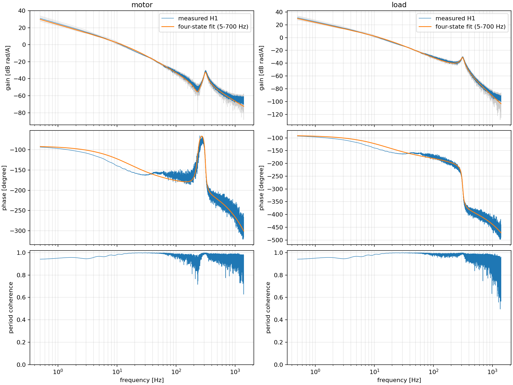
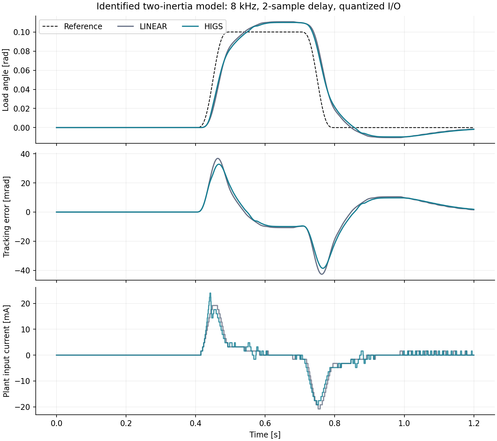
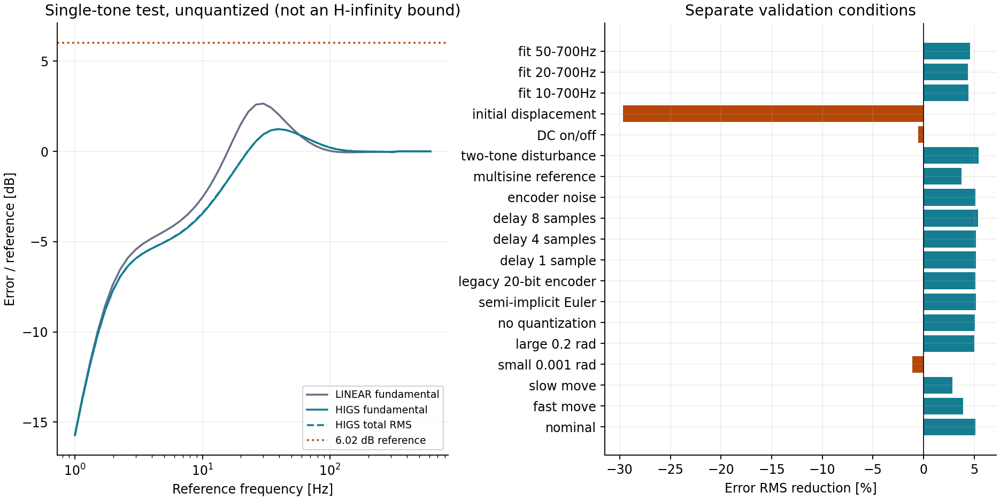

# HIGS の二慣性系実験と設計

> **位置づけ:** HIGS の実験準備、設計根拠、再現手順  
> **対象読者:** 実機の配線・ドライブ設定を把握する実験者、制御設計者  
> **更新条件:** HIGS、制御周期、PDO 換算、設計データ、停止処理を変更したとき  
> **関連文書:** [ExperimentProcedure](./ExperimentProcedure.md) / [TechnicalReference](../architecture/TechnicalReference.md) / [DriverAdapter](../modules/DriverAdapter.md)

## 1. 今回用意したものと、実機側に残る作業

既存の SOS 制御器に HIGS を一つ挿入し、同じ軌道で線形制御器と比較する `exp05_Higs` を追加した。制御計算は既存の C++ コアを使い、MATLAB は係数設定・実験実行・ログ回収を担当する。HIGS 用に別の実時間フレームワークは作っていない。

添付の旧 `chirp_result.mat` からモデルを求め、そのモデルに対して実際の `ControllerAlgorithm.cpp` を実行した。初回候補は、線形比較器の目標ゲイン交差周波数を 8 Hz とする。通常の往復動作では誤差 RMS が約 5.1% 減ったが、整定区間や初期値応答には悪化もある。実機で確認すべき候補であり、最適な調整値や非線形安定性を保証する値ではない。

| 項目 | 状態 |
|---|---|
| HIGS、係数反映、既存 SOS との切替 | 実装済み。C++ host tests 通過 |
| 毎周期の位置・速度・相対ねじれ保護、停止ラッチ | 実装済み。C++ host tests 通過 |
| 旧データの単位調査、FRF、二慣性モデル、設計比較 | 再現コードと結果を保存済み |
| MATLAB の preview／linear／higs 入口 | 実装・構文検査済み。MATLAB 本体での実行は未確認 |
| Windows / TwinCAT SDK でのモジュール再ビルド | 未実施 |
| 実 EtherCAT I/O、ドライブ設定、実機への反映 | 未実施。`RealMotor.tsproj` の I/O 定義は空 |

**現時点で「そのまま実機へ通電できる」とは扱わない。** リポジトリの `ExperimentHailMary.RealMotor.tsproj` は `<Io/>` が空で、`TIID^RealMotorPdo^RealMotorPdo Instance` への 11 個のリンクを持つ雛形である。実際の master/slave/PDO 定義を含む XAE プロジェクトが必要になる。対応させる信号は §7 に記載した。

主な入口は以下のとおり。

| ファイル | 用途 |
|---|---|
| [exp05_Higs.m](../../matlab/experiment/exp05_Higs.m) | preview と linear/HIGS の単一試行 |
| [ControllerAlgorithm.cpp](../../ControllerCore/ControllerAlgorithm.cpp) | 既存 SOS と離散時間 HIGS の実計算 |
| [higs_design.json](../../simulations/higs_design.json) | 8 kHz 用の係数、軌道、試行上限 |
| [identify_chirp.py](../../simulations/identify_chirp.py) | 添付形式の旧 MAT から FRF とモデルを再生成 |
| [higs_two_inertia.py](../../simulations/higs_two_inertia.py) | 実 C++ コアによる閉ループ比較、調整値の検討 |
| [identified_plant.json](../../simulations/data/identified_plant.json) | データの出所、単位、同定値、適合誤差 |
| [summary.json](../../simulations/results/summary.json) | 全ケースの数値、条件、コアの SHA-256 |

## 2. 旧データから分かったこと

旧保存コード [chirp_openloop.m](https://github.com/MONIN013/Experiment-Hail-Mary/blob/6bb96d39135b98355a68ebc68de5167a1733b87d/matlab/experiment/proto/chirp_openloop.m) は、添付と同じ変数名に対して `input` を control input [A]、`motorpos/loadpos` を [deg] と記載している。旧外部 config と取得関数の本体は履歴にないため、現在の 8 kHz・rad のログ形式をこの MAT へ適用しなかった。

| 項目 | 添付から確認した値 |
|---|---:|
| サンプリング周期 | 62.5 µs、16 kHz |
| 長さ | 100 s、1,600,000 samples |
| 周期 | 10 s × 10 周期 |
| 入力 | 振幅 0.5 A、0.4→8000 Hz の線形 chirp と整合 |
| 入力の数式照合誤差、第1周期 | 最大約 2.91×10⁻¹¹ A |
| 角度の刻み | 全点が厳密に 360 / 2²⁰ deg の整数倍 |
| 解析に用いた周期 | 第3〜10周期 |
| データ SHA-256 | `d882ff79015b8759f70110aaee2aebf039f4aa261c25994ee895e46800d8b4e4` |

`input` は電流指令として解釈する。別の実電流チャンネルは保存されていないので、同定対象は電流指令から角度までの系であり、電流ループや記録時刻の影響を含む。

位置には周期ごとに約26〜57度の移動が残り、入力にも約0.6246 mAの周期平均がある。生の位置をそのまま周期 FFT に入れるとドリフトが漏れるため、元の連続したサンプル境界で後退差分速度を求め、周期ごとのクロススペクトルから H1 推定を行った。非 DC 成分は次式で位置へ戻している。

\[
D(e^{j\omega T_s})=\frac{1-e^{-j\omega T_s}}{T_s},\qquad
\hat P_{\theta i}=\frac{\hat P_{v i}}{D(e^{j\omega T_s})}.
\]

角度は解析時に deg から rad へ換算した。coherence は残した8周期の再現性を表す。再現する非線形ひずみまで除外できる指標ではない。

### 2.1 二慣性モデルと適合範囲

motor/load を同時に 5〜700 Hz で当てはめた。入力ゲインを含む係数は独立には決まらないので、以下は \(K_t=1\) とした電流換算の有効値である。例えば \(\bar J_m=J_m/K_t\) であり、表の数値をそのまま kg·m² と読まない。

\[
\begin{aligned}
\bar J_m\ddot\theta_m&=i-\bar B_m\dot\theta_m
 -\bar K(\theta_m-\theta_\ell)-\bar C(\dot\theta_m-\dot\theta_\ell),\\
\bar J_\ell\ddot\theta_\ell&=-\bar B_\ell\dot\theta_\ell
 +\bar K(\theta_m-\theta_\ell)+\bar C(\dot\theta_m-\dot\theta_\ell).
\end{aligned}
\]

| パラメータ | 有効値 |
|---|---:|
| \(\bar J_m\) | 5.5465×10⁻⁵ |
| \(\bar J_\ell\) | 4.6691×10⁻⁵ |
| \(\bar K\) | 98.7849 |
| \(\bar C\) | 1.4814×10⁻³ |
| \(\bar B_m\) | 約 5.55×10⁻¹⁰、非負制約の下限付近 |
| \(\bar B_\ell\) | 1.03974×10⁻² |
| 減衰共振周波数 | 313.35 Hz |
| 共振の減衰比 | 0.04542 |
| motor/load 比から別に求めた反共振固有周波数 | 231.14 Hz |
| 共通の有効遅延 | 0.2400 ms、元の ZOH・記録時刻・未モデル化特性を含む |

現行 VirtualMotor の約200 Hzのプリセットと、この測定は一致しない。低周波の位相も4状態の受動モデルだけでは十分に合わず、10 Hz付近では負荷側モデルが実測より約17度進む。5〜700 Hzの複素相対誤差 RMS は motor 22.5%、load 17.6%。第3〜6周期で同定して第7〜10周期へ照合した場合は、それぞれ23.9%、19.5%だった。



そのため、ゲインはモデルだけで決めず、測定 FRF と各周期の応答にも直接照合した。16 kHz の FRF を8 kHzへ換算する際の ZOH 比はオフライン設計用の近似として扱い、元の `source_Ts` は保持した。電流ループや logger の対応時刻が同じとは確認できていないので、これを現行8 kHzの `plant.mat` の代わりにはしない。

## 3. 第8章から採用した構成

書籍第8章の図8.7、式(8.9)〜(8.11)では、線形比較器 \(C^*\) を HIGS と補償器 \(V=H^{-1}C^*\) に分ける。今回の構成は、LPF を HIGS 一つに置き換えるところまでに絞った。同章の二つの HIGS を使う PID や実験 Table 8.2 全体の再現ではない。

線形比較器は次式とした。

\[
C_L(s)=K_p\frac{s+\omega_i}{s}
\frac{1+s/\omega_z}{1+s/\omega_p}
\frac{\omega_\ell^2}{s^2+\sqrt2\omega_\ell s+\omega_\ell^2}.
\]

\(k_h=1\)、\(H(s)=\omega_c/(s+\omega_c)\) として、誤差信号を HIGS に通した後へ \(V(s)=H^{-1}(s)C_L(s)\) を置く。\(H^{-1}\) 単体を非プロパーな微分器として実装せず、2次 LPF とまとめてプロパーな SOS にする。HIGS を \(H\) に置き換えれば線形比較器へ戻るため、同じ目標線形特性から非線形化の効果を比較できる。

HIGS は DC で有限ゲインを持つ。元の I 要素をそのまま HIGS に置き換えると一定外乱への性質まで変わるので、この構成では通常の PI の積分器を残した。

### 3.1 実装した離散時間則

実装には第8章の連続時間図をそのまま Euler 化したものを使わず、§2.4 の式(2.43)〜(2.44)の trimodal HIGS を用いた。現在入力を \(z_k\)、前回出力を \(h_{k-1}\) とすると、候補値は

\[
\hat h_k=h_{k-1}+\omega_hT_s z_k
\]

であり、次の順序で出力を決める。

1. 候補が \([\min(0,k_hz_k),\max(0,k_hz_k)]\) 内なら \(h_k=\hat h_k\)。
2. 範囲外で \(z_kz_{k-1}\ge0\) なら \(h_k=k_hz_k\)。
3. それ以外は \(h_k=0\)。

符号変化があっても、最初の sector 判定を優先する。実装は乗算のオーバーフローを避けて上下限で判定し、\(k_h>0\)、\(0<\omega_hT_s\le k_h\) を設定時に検査する。reset では前回入力・出力を0にする。SOS と HIGS の設定は同じ `SosApplyRevision` で一括反映し、不正設定は旧設定と内部状態を保ったまま拒否する。

連続時間の代表近似に合わせて

\[
\omega_c=\frac{\omega_h}{k_h}\sqrt{1+\frac{16}{\pi^2}}
\]

とした。線形部分は Tustin、HIGS は上記の後退差分型の則を使う。単一正弦波に対する位相改善の目安は設計に使えるが、複数周波数を含む実験を記述関数だけで評価しない。

### 3.2 初回候補

| 設定 | 値 |
|---|---:|
| 制御周期 | 125 µs、8 kHz |
| 線形比較器の目標ゲイン交差 | 8 Hz、旧測定 FRF のゲインに合わせる |
| \(K_p\) | 0.18660704 A/rad |
| PI の折点 | 2 Hz |
| lead の零点／極 | 2.6667 / 24 Hz |
| 2次 LPF | 100 Hz、Butterworth |
| HIGS に対応させる \(H\) の折点 | 20 Hz |
| \(k_h\) | 1 |
| \(\omega_h T_s\) | 0.00970230350436 |
| HIGS の前の SOS | 0 段 |
| HIGS の後の SOS | 3 段 |
| 前置フィルタ \(W\) | なし |

8 Hz は線形比較器の調整目標であり、HIGS に一意の LTI ゲイン交差周波数を割り当てた値ではない。線形比較器を8/10/15/20 Hzへ調整したときの感度比較は `summary.json` の `bandwidth_comparison` に残している。

## 4. シミュレーションの結果と解釈

既存 `ControllerAlgorithm.cpp` を一時共有ライブラリへコンパイルし、Python から呼んだ。C++ と別の HIGS 近似式を閉ループへ入れた結果ではない。プラントは4状態モデルを ZOH で離散化し、電流上限、電流指令の量子化、角度量子化、遅延を含めた。

標準条件は0.1 radの往復、移動0.1 s、折返し前の停止0.2 s、前後の待機各0.4 s。7次 smoothstep を使い、始終端の速度・加速度・jerk を0にした。計1.2 s、9601 samplesである。ZOHとは別に2 samplesの遅延を置いた。これは旧記録から現在の実機遅延を確定した値ではなく、初回比較のモデル条件である。電流量子1.6 mAと角度23 bitは現行 DriverAdapter の既定値を仮定し、旧データと同じ20 bit相当も別ケースで試した。実機の変換値を確認済みという意味ではない。

### 4.1 線形の余裕と、選んだ不確かさ

| 評価 | 値 |
|---|---:|
| 名目モデルでの線形最大感度 | 1.3597 |
| 名目モデルの閉ループ固有値の最大絶対値 | 0.998971 |
| 旧測定 H1 に対する最大感度、ZOH近似補正後 | 1.4113 |
| 旧測定の8周期中の最大感度 | 1.4662 |
| 各周期へ追加0.75 msの遅延を与えた最大感度 | 1.5350 |
| 選んだ96条件のモデルでの最大感度 | 1.8454、設定上限2以内 |

96条件は \(\bar J_m,\bar J_\ell,\bar K\) を各±20%、\(\bar C\) と接地粘性を各0.5/1.5倍、追加遅延を1/4/8 samplesとした組合せである。接地粘性の \(\bar B_m,\bar B_\ell\) には同じ倍率を掛けた。\(\bar B_m\) はもともとほぼ0なので、広い範囲の motor 側粘性を調べたことにはならない。

線形系は感度の値だけでなく、SOS・プラント・遅延の閉ループ状態行列の固有値を確認した。96条件と、異なる同定帯域の3モデル、semi-implicit Euler の場合にも、この線形安定性を確認している。これらは選んだ条件での確認であり、HIGS 閉ループの大域的安定性証明ではない。

### 4.2 誤差と電流

以下は実機結果ではなく、同定モデル上の結果である。正の「改善率」は誤差 RMS の減少を表す。

| 条件 | 線形 RMS [mrad] | HIGS RMS [mrad] | 改善率 |
|---|---:|---:|---:|
| 標準往復 | 12.226 | 11.597 | 5.15% |
| 0.05 sの速い移動 | 14.533 | 13.965 | 3.91% |
| 0.2 sの遅い移動 | 9.010 | 8.753 | 2.85% |
| 1 mradの微小指令 | 0.512 | 0.518 | −1.09% |
| 0.2 radの往復 | 24.300 | 23.079 | 5.02% |
| 複数正弦波の位置指令 | 10.003 | 9.627 | 3.76% |
| 3 Hz＋313 Hzの電流指令加算 | 9.464 | 8.951 | 5.42% |
| 一定電流指令加算の on/off | 2.506 | 2.519 | −0.52% |
| 初期位置0.005 radからの復帰 | 0.251 | 0.325 | −29.69% |

標準往復について、全区間の RMS は減った一方、最後の0.2 sの RMS は5.798→6.039 mrad、最大プラント入力電流は20.8→24.0 mA、250〜380 Hzの相対ねじれ RMS は3.023→3.511 µradに増えた。全区間の RMS だけを目的にすると、整定誤差や共振帯域の振動を見落とす。



選んだ96条件では、同じ標準軌道の RMS が4.36〜8.45%減少した。その他の19条件と合わせた115組の比較では、両制御器とも試行上限内で、電流指令のクリップはなかった。全ケースの最大要求電流は64.99 mA、最大角速度4.010 rad/s、最大位置0.2222 rad、最大相対ねじれ0.0005211 radだった。

電流加算ケースは、制御器出力へ加算した後で上限制限・量子化・遅延へ通している。負荷側へ直接加わる機械的外乱トルクを試験した結果ではない。



単一正弦波の試験では、量子化なし・振幅0.01 radで、基本波の誤差／指令振幅比の最大値は線形1.357、HIGS1.153だった。HIGSの全成分 RMS 比も併記した。この有限の振幅・周波数で得た比を、非線形系の \(H_\infty\) ノルムや任意入力に対する保証とは呼ばない。

## 5. 調整から得られた知見

**HIGS の折点を下げるだけでは良くならない。** 対応する \(H\) の折点を1 Hzへ下げると、前置フィルタなしでも要求電流が274.6 mAとなり、80 mA制限で299 samplesがクリップした。前置20 Hzフィルタを加えた場合は669.4 mA、1047 samplesだった。この条件は採用していない。post 段に通常の積分器を残しており、飽和を前提とする anti-windup の設計は行っていない。

**前置フィルタ \(W\) は、HIGS の前後で単純には相殺しない。** 第8章の \(W\to\mathrm{HIGS}\to W^{-1}V\) は、非線形素子へ入る周波数成分を調整する構成である。初回候補の20 Hzに前置20 Hzを追加すると、標準軌道の RMS は11.597→11.564 mradとわずかに減る一方、共振帯域の電流 RMS は0.1308→0.1977 mAへ約51%増えた。このデータでは、まず \(W\) なしで比較する方が因果を読み取りやすい。

**微小指令では電流分解能と摩擦の確認が先になる。** 1 mradでは改善しなかった。1.6 mAの電流指令量子化を含めており、連続値だけのシミュレーションから改善を期待できない。さらに旧0.5 A chirpで得たモデルから、微小電流時の stiction を特定できていない。

**追従と初期値応答を分けて評価する。** 目標軌道の RMS は改善しても、初期変位からの復帰は悪化した。実験では同じ停止状態から始め、全区間 RMS、移動中の最大誤差、整定区間 RMS、電流、ねじれの各値を比較する。A–B–B–Aなどの順に linear/HIGS を繰り返せば、温度や摩擦変動による偏りも確認しやすい。

**線形の感度検査と非線形安定性を混同しない。** 実装した sector 条件は HIGS 単体の性質であり、閉ループ全体の保証には別の議論が必要である。書籍§2.4や離散時間 HIGS の論文にある周波数条件・LMIを用いる場合も、切り出した線形部が満たすべき安定性などの仮定を確認する。今回の PI と位置プラントへ定理をそのまま適用したという扱いはしていない。

## 6. オフラインでの再現

以下はLinux/WSL向けの再現コマンドで、Python 3.12、g++ を用意し、リポジトリ直下で実行する。検証時は Python 3.12.14、NumPy 2.3.5、SciPy 1.17.0、Matplotlib 3.10.8、g++ 14.2.0を使った。TwinCATの実験実行とSDKビルドはWindows側で行う。

```sh
python3 -m pip install -r simulations/requirements.txt
# 元のMATを指定した場合だけ同定データを再生成する。
python3 simulations/identify_chirp.py --input /path/to/chirp_result.mat
# 同梱した同定結果からの比較は、元のMATがなくても実行できる。
OPENBLAS_NUM_THREADS=1 python3 simulations/higs_two_inertia.py --write-design
```

共有ライブラリは一時ディレクトリへ作る。設計JSONは、選択した比較ケースの運動・電流・線形安定性・感度の検査がすべて通った後で更新する。不合格の調整値を実験用JSONへ残さない。`data` と `results` は派生結果で、元の MAT は変更しない。

C++ の数値コアは次でも検査できる。

```sh
g++ -std=c++17 -Wall -Wextra -Werror -O2 -IControllerCore \
  ControllerCore/ControllerAlgorithm.cpp ControllerCore/tests/ControllerAlgorithmTests.cpp \
  -o /tmp/controller_tests
/tmp/controller_tests

g++ -std=c++17 -Wall -Wextra -Werror -O2 -IDriverAdapter -ICommonLib \
  DriverAdapter/DriverAdapterAlgorithm.cpp CommonLib/TcNumeric.cpp CommonLib/TcUnits.cpp \
  DriverAdapter/tests/DriverAdapterAlgorithmTests.cpp -o /tmp/driver_tests
/tmp/driver_tests
```

HIGS の3モード、sector 境界、符号変化時の優先順、全挿入位置、reset、無効設定の拒否、overflowを含む。DriverAdapter は既存の100万scan比較に加え、各保護、同一scanのゼロ出力、通常reset後のラッチ保持、明示解除条件を検査する。これらは TwinCAT SDK ビルドや実機の停止時間の測定を代替しない。

## 7. 実機へ反映する手順

### 7.1 再ビルドと実 I/O

Windows / TwinCAT SDK 環境で ControllerCore と DriverAdapter を `Release / TwinCAT RT (x64)` で再ビルドし、XAEへ新しい TMC を反映する。リポジトリにある古い配備用 TMX は今回の追加パラメータ・Outputsを含まないため、そのまま使わない。実機構成へ適用後、新しい HIGS / Safety シンボルの readback を確認する。

実 PDO に対応づける11信号は以下である。型や単位が異なる場合は、ドライブ側の scaling か DriverAdapter の変換を合わせる。

| 向き | DriverAdapter の信号 | 現行の前提 |
|---|---|---|
| motor → runtime | `motorRaw.positionActualValue` | DINT、位置 count |
| motor → runtime | `motorRaw.velocityActualValue` | DINT、count/s |
| motor → runtime | `motorRaw.torqueActualValue` | INT、定格電流の per mille |
| motor → runtime | `motorRaw.statusWord` | UINT、StatusWord |
| load → runtime | `loadRaw.positionActualValue` | DINT、位置 count |
| load → runtime | `loadRaw.velocityActualValue` | DINT、count/s |
| load → runtime | `loadRaw.torqueActualValue` | INT、定格電流の per mille |
| load → runtime | `loadRaw.statusWord` | UINT、StatusWord |
| runtime → motor | `motorControlWordOut` | UINT、ControlWord |
| runtime → load | `loadControlWordOut` | UINT、ControlWord |
| runtime → motor | `targetTorque` | INT、定格電流の per mille 指令 |

表のraw入力は `Inputs.*`、出力は `Outputs.*` にある。load の targetTorque はこの契約に含まれない。一方、PLCは両ドライブの OPERATION_ENABLED を待つため、load 側は実験に合う動作モードとゼロトルク条件に設定する必要がある。意図しない位置保持・速度保持が働けば、今回の二慣性モデルとは異なる対象になる。

モータ側も targetTorque を受け付ける動作モードが必要で、現在の PLC は mode of operation 自体を書いていない。ドライブ型式が不明なため、mode number や SDO を推測して指定してはいない。

### 7.2 周期と換算値

両 tsproj の高速タスクは125 µsである。実際に activate した周期が8 kHzであることを確認する。旧MATの16 kHzに合わせて、現在の係数をそのまま使うことはできない。

現行既定は両軸 `encoderResolution=8388608`、`ratedCurrentA=1.6`。ここでの分解能は、ドライブ内の gearing/scaling を含めて、機械軸1回転で PDO が何count変わるかである。旧データは20 bit相当の刻みを持つが、現 PDO の設定を確定する情報にはならない。仮に PDO が1048576 count/revのまま23 bitの設定を使うと、角度・速度を1/8に換算し、位置・速度の保護が物理量に対して8倍緩くなる。

電流も `raw × ratedCurrentA / 1000` の前提を確認する。両軸の位置・速度の向きと、モータ電流の正方向を合わせる。`exp05_Higs` はこれらを読み取って結果へ保存するが、自動変更はしない。

DriverAdapterはPDOの鮮度やWcStateを入力として持たないため、古いフィードバックが残る通信障害は今回の位置・速度保護だけでは検出できない。実EtherCATとドライブのwatchdogによる出力停止を設定する。ControlWord=0はソフトウェア上のdisable要求であり、非常停止/STOや実停止時間を検証済みという意味ではない。

### 7.3 現行条件での再同定

PDO・符号・換算・停止動作を確認した後、現在の8 kHz環境で `experiment.scenario.exp01` / `experiment.workflow.run_exp01` を使い、別の結果ディレクトリへ `plant.mat` を作る。既存の `exp01_SysId.m` の0.25 Aや100秒はVM用の既定値なので、実機へそのまま適用しない。実機の電流上限・可動範囲に合う短い入力から、波形とログを確認して測定長を決める。今回の試行上限を再同定にも使う場合は、あらかじめXAEでDriverAdapterのSafetyLimitsと電流上限を設定し、有効にしてから開始する。

`exp01` の `Jn` / `Dn` / `sample_delay` は指定値から nominal model を作る。初期値としては同定JSONの \(\bar J_m+\bar J_\ell\approx1.02156\times10^{-4}\)、\(\bar B_m+\bar B_\ell\approx0.0103974\)、遅延2sampleを参照できるが、低域のモデル誤差と新しい測定結果を確認して採用する。旧16 kHzのFRFの `Ts` だけを書き換えて、この手順を省略しない。

`exp05_Higs` はADS接続前に、現在の周期に一致するSISOの `Pd/Pdn`、1〜500 Hz以上を含む正周波数データ、有限値、nominal線形閉ループの安定性、測定点での線形最大感度2以下を要求する。位置への離散積分で生じるDC特異点だけは除外する。データが今の装置に対応することや測定Nyquistの巻き数までは自動証明しないため、生成したファイルの出所も確認する。

### 7.4 preview と比較試行

MATLABの初回セットアップ後、previewはADS接続なしで動く。

```matlab
run('matlab/setup_matlab_environment.m')
p = exp05_Higs("preview");
```

物理設定と再同定の完了後、使用する `plant.mat` を明示して1試行ずつ実行する。

```matlab
plant_path = 'C:/experiment/current_8khz/plant.mat';
result_dir = 'C:/experiment/higs_comparison';
a = exp05_Higs("linear", "target_label", "bench-A", ...
    "plant_path", plant_path, "result_dir", result_dir);
b = exp05_Higs("higs", "target_label", "bench-A", ...
    "plant_path", plant_path, "result_dir", result_dir);
```

`target_label` は記録用の名前で、接続先やVM/実機を切り替えない。接続は既存の `cfg.env` に従う。設定snapshotと `io_backend_verified=false` を結果へ保存する。実行前に同じ静止状態へ戻し、各試行のログを見てから次へ進む。

既定の試行上限は電流80 mA、両軸の相対位置0.25 rad、速度10 rad/s、相対ねじれ0.01 rad。これらはこの設計の試行条件であり、実機の定格・可動範囲から確認した値ではない。実機により厳しい上限が既に設定されていれば、`exp05_Higs` はそれを緩めず、書き込み前に拒否する。

実行中の位置・速度・ねじれ逸脱は、DriverAdapterがその計算周期で電流と両ControlWordを0にし、停止をラッチする。ホストのADSポーリングだけに停止を任せていない。終了時はmodeFlags=0、通常reset、IDLE確認、元の上限の復旧とreadback、接続closeの順に処理する。

試行ごとに `result_dir/exp05/<UTC日時+一意suffix>/` を作り、`result.mat`、`runner.mat`、失敗時の `failure.mat` を分ける。取得したrawデータを保存してから受入判定するため、比較を繰り返しても過去の結果を上書きしない。結果には電流指令・実測電流、誤差、入力換算値、制御器、設定、保護状態が含まれる。`accepted` はログ契約・完了状態・電流条件等の受入結果であり、HIGSが線形より良いことを意味しない。

`Outputs.higsInput/higsOutput/higsMode` はADS/Scopeで観測できる。既存の104-byte logger recordには追加していないので、通常のbinary logだけから毎周期のmodeを測定したとは扱わない。またログの時刻列はsample番号と周期から作ったもので、実ジッタの測定値ではない。

### 7.5 保護停止後

通常resetやMATLABのcleanupでは安全ラッチを解除しない。code 1は位置、2は速度、3は相対ねじれ、4は保護設定・換算値の不正を示す。`failure.mat`で安全状態の読み取りに失敗した場合は `safety_observation_valid=false` とし、「tripなし」と断定しない。

原因を確認した後、電流出力がdisabledで、motor/load両方の入力ControlWordがoperation enableを要求していない状態で、XAEから `SafetyResetRevision` を新しい値へ更新する。危険状態で送ったrevisionは消費され、停止後に自動解除されることはない。新たな更新が必要である。相対ねじれ保護はreset時の位置からの変化を見るため、初期状態にあった軸の予圧・ねじれは測っていない。

## 8. 検証の範囲と参考資料

この変更ではC++数値コア試験、独立のsector判定との比較、モデル・SOSの数値照合、TMC/tsprojの型幅とoffset照合、MATLAB R2021a構文検査を行った。MATLAB unit testsは追加したが、MATLAB実行環境がないため実行していない。Windows/TwinCAT SDKのビルド、実PDOの検証、モータの運転も未実施である。

- S. van den Eijnden, M. Heertjes, M. Heemels, H. Nijmeijer, *Hybrid Integrator-Gain Systems: Analysis, Design and Applications*, Springer, 2026. [DOI](https://doi.org/10.1007/978-3-032-18101-5)。第8章は印刷185〜214頁。今回のLPF整形は印刷195頁/PDF201頁、図8.7・式(8.9)〜(8.11)。離散実装は§2.4、印刷36〜38頁/PDF48〜50頁。
- B. Sharif, D. Alferink, M. Heertjes, H. Nijmeijer, M. Heemels, “Analysis of sampled-data hybrid integrator-gain systems: A discrete-time approach,” *Automatica*, 167, 111765, 2024. [DOI](https://doi.org/10.1016/j.automatica.2024.111765) / [著者所属機関の公開情報](https://research.tue.nl/en/publications/analysis-of-sampled-data-hybrid-integrator-gain-systems-a-discret/)。離散時間モデルと、仮定を満たす場合の安定性解析の出典。
- 旧取得形式の単位根拠は§2のcommit固定リンク、数値の出所と計算条件は同梱の `identified_plant.json` と `summary.json`。原データと書籍PDFはリポジトリへコピーしていない。
