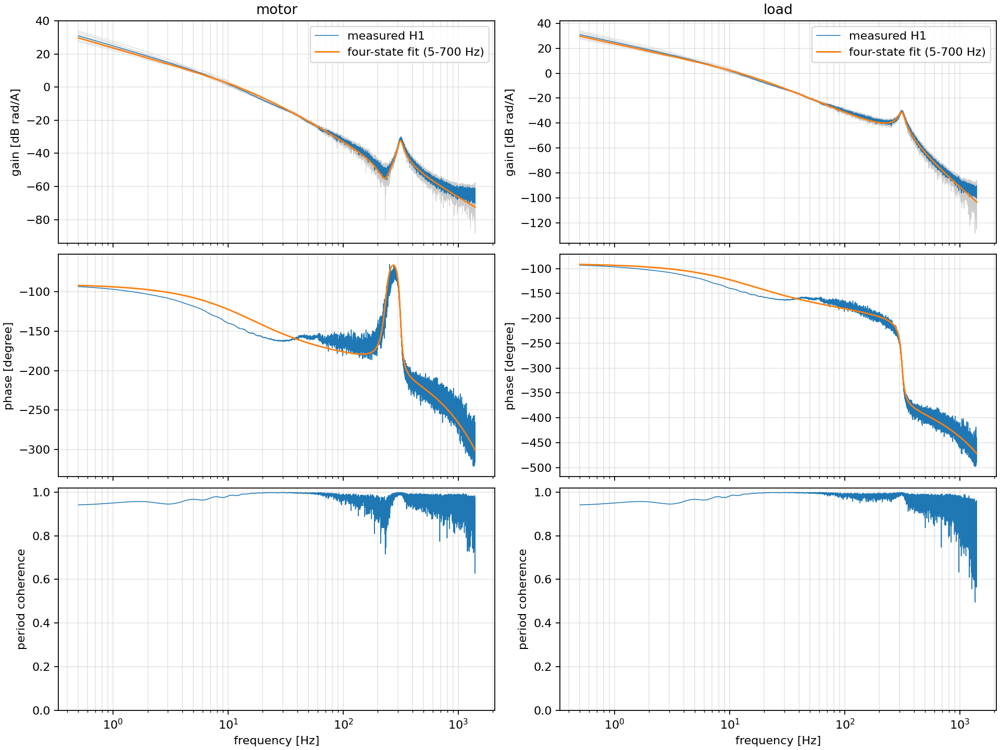
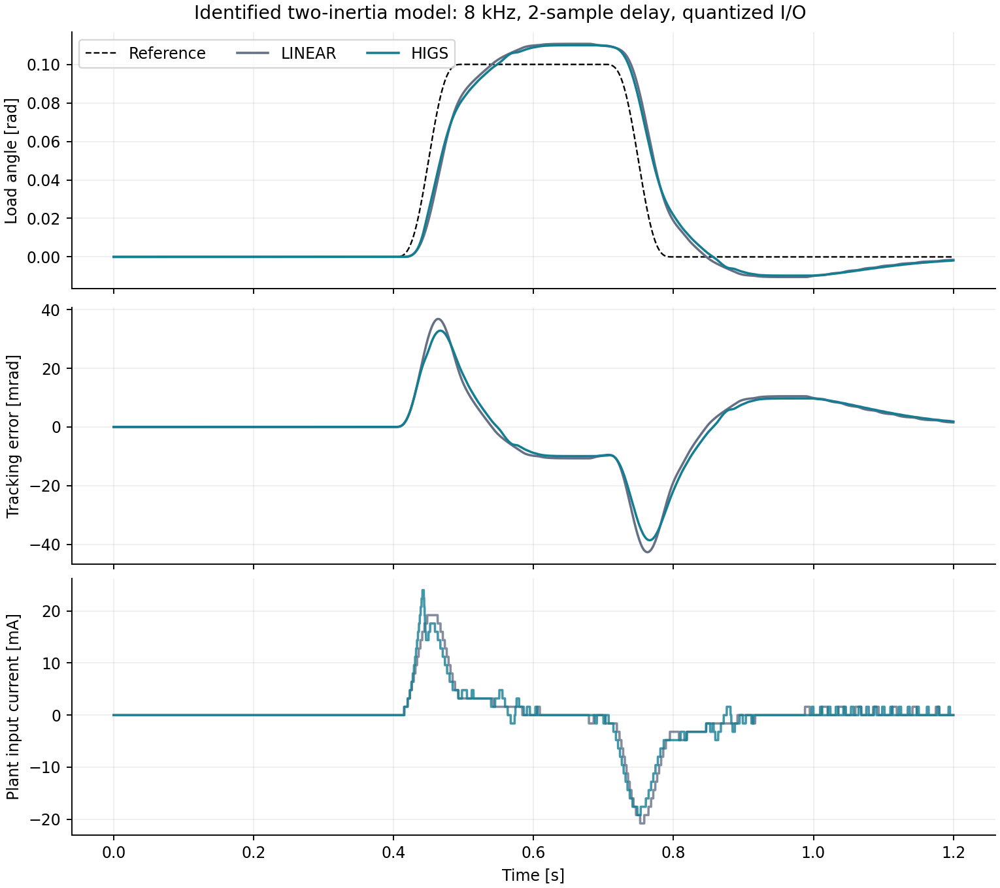

# HIGS の二慣性系実験と設計

> **位置づけ:** HIGS の実験準備、設計根拠、再現手順  
> **対象読者:** 実機の配線・ドライブ設定を把握する実験者、制御設計者  
> **更新条件:** HIGS、制御周期、PDO 換算、設計データ、停止処理を変更したとき  
> **関連文書:** [ExperimentProcedure](./ExperimentProcedure.md) / [TechnicalReference](../architecture/TechnicalReference.md) / [DriverAdapter](../modules/DriverAdapter.md)

## 1. 今回用意したものと、実機側に残る作業

図8.9のLPブロックとIブロックに、それぞれ独立したHIGSを実装した。`exp05_Higs` は同じ線形設計から `linear`・`integrator`・`lowpass`・`both` を生成する。制御計算は既存の C++ コアを使い、MATLAB は係数設定・実験実行・ログ回収を担当する。HIGS 用に別の実時間フレームワークは作っていない。

§4・§5と保存済みの図・`simulations/results` の `summary.json`・`tracking.png`・`validation.png` は、変更前の単一HIGS（Hの折点20 Hz）に対する結果であり、現在の二HIGS構成の性能を示さない。§9は旧16 kHzデータに基づくモデル上の比較で、実機の結論ではない。実機（16 kHz）での同定・設計・比較は§11、設計指針は§10に置いた。

現行の設計値とオフライン評価は§12、実測比較は§11.2、教科書との対応は§13を参照する。旧設計の実機数値・図は現行設計の根拠から外し、必要時にgit履歴で参照する。

添付の旧 `chirp_result.mat` からモデルを求め、そのモデルに対して実際の `ControllerAlgorithm.cpp` を実行した。初回候補は、線形比較器の目標ゲイン交差周波数を 8 Hz とする。通常の往復動作では誤差 RMS が約 5.1% 減ったが、整定区間や初期値応答には悪化もある。実機で確認すべき候補であり、最適な調整値や非線形安定性を保証する値ではない。

| 項目 | 状態 |
|---|---|
| HIGS、係数反映、既存 SOS との切替 | 実装済み。C++ host tests 通過 |
| 毎周期の位置・速度・相対ねじれ保護、停止ラッチ | 実装済み。C++ host tests 通過 |
| 旧データの単位調査、FRF、二慣性モデル、設計比較 | 再現コードと結果を保存済み |
| MATLAB の preview／linear／integrator／lowpass／both 入口 | 実装済み。実機比較は `exp05_Higs` の preview で制御器を作り、試行は `matlab/tools/higs_bench/` の `higs_bench_trial` で回した。`exp05_Higs` の実機一括実行（`plant.mat` を含む）は16 kHzで未実施 |
| Windows / TwinCAT SDK でのモジュール再ビルド | 16 kHz（62.5 µs）で全モジュールをビルドし、ターゲットへ有効化済み |
| 実 EtherCAT I/O | `ExperimentHailMary.tsproj` に EK1100＋ELM7211-0011×2（SM-Synchron）を定義。CoE で定格・分解能・符号を確認し、DriverAdapter の値を tsproj に保存済み（§11.1） |

`ExperimentHailMary.RealMotor.tsproj` は EtherCAT 構成を持たない雛形のままである。

主な入口は以下のとおり。

| ファイル | 用途 |
|---|---|
| [exp05_Higs.m](../../matlab/experiment/exp05_Higs.m) | preview と4モードの単一試行 |
| [ControllerAlgorithm.cpp](../../ControllerCore/ControllerAlgorithm.cpp) | 既存 SOS と離散時間 HIGS の実計算 |
| [higs_design.json](../../simulations/higs_design.json) | 旧8 kHzモデル比較用。現行exp05の読込形式ではない |
| [higs_book_design.py](../../simulations/higs_book_design.py) | 現行の帯域最大化と保存設計の再評価（16 kHz） |
| [simulations/hardware/](../../simulations/hardware/) | 実機の生ログ（`frf/` マルチサインと FRF、`trials/` A–B–B–A と感度）と設計（`designs/`） |
| [matlab/tools/higs_bench/](../../matlab/tools/higs_bench/README.md) | 実機試行・同定・感度測定の MATLAB 関数 |
| [identify_chirp.py](../../simulations/identify_chirp.py) | 添付形式の旧 MAT から FRF とモデルを再生成 |
| [higs_two_inertia.py](../../simulations/higs_two_inertia.py) | 実 C++ コアによる閉ループ比較、調整値の検討 |
| [identified_plant.json](../../simulations/data/identified_plant.json) | データの出所、単位、同定値、適合誤差 |
| [summary.json](../../simulations/results/summary.json) | 全ケースの数値、条件、コアの SHA-256 |

## 2. 旧データから分かったこと

旧保存コード [chirp_openloop.m](https://github.com/MONIN013/Experiment-Hail-Mary/blob/6bb96d39135b98355a68ebc68de5167a1733b87d/matlab/experiment/proto/chirp_openloop.m) は、添付と同じ変数名に対して `input` を control input [A]、`motorpos/loadpos` を [deg] と記載している。旧外部 config と取得関数の本体は履歴にないため、現在の 8 kHz・rad のログ形式をこの MAT へ適用しなかった。

| 項目 | 添付から確認した値 |
|---|---:|
| サンプリング周期 | 62.5 µs、16 kHz |
| 長さ | 100 s、1,600,000 samples |
| 周期 | 10 s × 10 周期 |
| 入力 | 振幅 0.5 A、0.4→8000 Hz の線形 chirp と整合 |
| 入力の数式照合誤差、第1周期 | 最大約 2.91×10⁻¹¹ A |
| 角度の刻み | 全点が厳密に 360 / 2²⁰ deg の整数倍 |
| 解析に用いた周期 | 第3〜10周期 |
| データ SHA-256 | `d882ff79015b8759f70110aaee2aebf039f4aa261c25994ee895e46800d8b4e4` |

`input` は電流指令として解釈する。別の実電流チャンネルは保存されていないので、同定対象は電流指令から角度までの系であり、電流ループや記録時刻の影響を含む。

位置には周期ごとに約26〜57度の移動が残り、入力にも約0.6246 mAの周期平均がある。生の位置をそのまま周期 FFT に入れるとドリフトが漏れるため、元の連続したサンプル境界で後退差分速度を求め、周期ごとのクロススペクトルから H1 推定を行った。非 DC 成分は次式で位置へ戻している。

\[
D(e^{j\omega T_s})=\frac{1-e^{-j\omega T_s}}{T_s},\qquad
\hat P_{\theta i}=\frac{\hat P_{v i}}{D(e^{j\omega T_s})}.
\]

角度は解析時に deg から rad へ換算した。coherence は残した8周期の再現性を表す。再現する非線形ひずみまで除外できる指標ではない。

### 2.1 二慣性モデルと適合範囲

motor/load を同時に 5〜700 Hz で当てはめた。入力ゲインを含む係数は独立には決まらないので、以下は \(K_t=1\) とした電流換算の有効値である。例えば \(\bar J_m=J_m/K_t\) であり、表の数値をそのまま kg·m² と読まない。

\[
\begin{aligned}
\bar J_m\ddot\theta_m&=i-\bar B_m\dot\theta_m
 -\bar K(\theta_m-\theta_\ell)-\bar C(\dot\theta_m-\dot\theta_\ell),\\
\bar J_\ell\ddot\theta_\ell&=-\bar B_\ell\dot\theta_\ell
 +\bar K(\theta_m-\theta_\ell)+\bar C(\dot\theta_m-\dot\theta_\ell).
\end{aligned}
\]

| パラメータ | 有効値 |
|---|---:|
| \(\bar J_m\) | 5.5465×10⁻⁵ |
| \(\bar J_\ell\) | 4.6691×10⁻⁵ |
| \(\bar K\) | 98.7849 |
| \(\bar C\) | 1.4814×10⁻³ |
| \(\bar B_m\) | 約 5.55×10⁻¹⁰、非負制約の下限付近 |
| \(\bar B_\ell\) | 1.03974×10⁻² |
| 減衰共振周波数 | 313.35 Hz |
| 共振の減衰比 | 0.04542 |
| motor/load 比から別に求めた反共振固有周波数 | 231.14 Hz |
| 共通の有効遅延 | 0.2400 ms、元の ZOH・記録時刻・未モデル化特性を含む |

現行 VirtualMotor の約200 Hzのプリセットと、この測定は一致しない。低周波の位相も4状態の受動モデルだけでは十分に合わず、10 Hz付近では負荷側モデルが実測より約17度進む。5〜700 Hzの複素相対誤差 RMS は motor 22.5%、load 17.6%。第3〜6周期で同定して第7〜10周期へ照合した場合は、それぞれ23.9%、19.5%だった。



そのため、ゲインはモデルだけで決めず、測定 FRF と各周期の応答にも直接照合した。16 kHz の FRF を8 kHzへ換算する際の ZOH 比はオフライン設計用の近似として扱い、元の `source_Ts` は保持した。電流ループや logger の対応時刻が同じとは確認できていないので、これを現行8 kHzの `plant.mat` の代わりにはしない。

## 3. 第8章から採用した構成

図8.9の並列PIDに合わせ、現行の信号順序を次のようにする（係数とフィルタ式は§12.2）。

```text
e → HIGS_lp/H_lp → k_p V_lp → {PD || W_i → HIGS_i/H_i → W_i^-1 H_i^-1 ω_i/s}
                           → 和 → notch → +FF
```

線形対応物は `C_lin = k_p C_lp [PD + ω_i/s] N`、`PD=(1+s/ω_d)/(1+s/ω_r)` である。積分枝にはPDを掛けない。両HIGSを線形Hに置き換えると、WとHが逆フィルタと相殺する。非線形の場合、WはHIGSへ入る周波数成分を変える。

係数配列は `[lpPre; Hlp; lpPost; P; iPre; Hi; iPost; Post]`。6区間の段数はHの2行を含まず、総段数は6区間の和+2（最大10）。HIGSを有効にしたブロックは、対応するHの1行を非線形素子へ置き換える。

### 3.1 実装した離散時間則

実装には第8章の連続時間図をそのまま Euler 化したものを使わず、§2.4 の式(2.43)〜(2.44)の trimodal HIGS を用いた。現在入力を \(z_k\)、前回出力を \(h_{k-1}\) とすると、候補値は

\[
\hat h_k=h_{k-1}+\omega_hT_s z_k
\]

であり、次の順序で出力を決める。

1. 候補が \([\min(0,k_hz_k),\max(0,k_hz_k)]\) 内なら \(h_k=\hat h_k\)。
2. 範囲外で \(z_kz_{k-1}\ge0\) なら \(h_k=k_hz_k\)。
3. それ以外は \(h_k=0\)。

符号変化があっても、最初の sector 判定を優先する。実装は乗算のオーバーフローを避けて上下限で判定し、\(k_h>0\)、\(0<\omega_hT_s\le k_h\) を設定時に検査する。reset では前回入力・出力を0にする。SOS と HIGS の設定は同じ `SosApplyRevision` で一括反映し、不正設定は旧設定と内部状態を保ったまま拒否する。

連続時間の代表近似に合わせて

\[
\omega_c=\frac{\omega_h}{k_h}\sqrt{1+\frac{16}{\pi^2}}
\]

とした。線形部分は Tustin、HIGS は上記の後退差分型の則を使う。単一正弦波に対する位相改善の目安は設計に使えるが、複数周波数を含む実験を記述関数だけで評価しない。

### 3.2 初回候補

| 設定 | 値 |
|---|---:|
| 制御周期 | 125 µs、8 kHz |
| 線形比較器の目標ゲイン交差 | 8 Hz、旧測定 FRF のゲインに合わせる |
| \(K_p\) | 0.18660704 A/rad |
| PI の折点 | 2 Hz |
| lead の零点／極 | 2.6667 / 24 Hz |
| 2次 LPF | 100 Hz、Butterworth |
| LP / I のH折点 | 100 / 2 Hz |
| \(k_h\) | 1 |
| LP / I の \(\omega_h T_s\) | 約0.0485115 / 0.000970230 |
| LP / I の前置SOS | どちらも0段 |
| LP / I の後置SOS | 1 / 1段（Iのleadを含む） |
| 前置フィルタ \(W\) | なし |

8 Hz は線形比較器の調整目標であり、HIGS に一意の LTI ゲイン交差周波数を割り当てた値ではない。線形比較器を8/10/15/20 Hzへ調整したときの感度比較は `summary.json` の `bandwidth_comparison` に残している。

## 4. シミュレーションの結果と解釈

既存 `ControllerAlgorithm.cpp` を一時共有ライブラリへコンパイルし、Python から呼んだ。C++ と別の HIGS 近似式を閉ループへ入れた結果ではない。プラントは4状態モデルを ZOH で離散化し、電流上限、電流指令の量子化、角度量子化、遅延を含めた。

標準条件は0.1 radの往復、移動0.1 s、折返し前の停止0.2 s、前後の待機各0.4 s。7次 smoothstep を使い、始終端の速度・加速度・jerk を0にした。計1.2 s、9601 samplesである。ZOHとは別に2 samplesの遅延を置いた。これは旧記録から現在の実機遅延を確定した値ではなく、初回比較のモデル条件である。電流量子1.6 mAと角度23 bitは現行 DriverAdapter の既定値を仮定し、旧データと同じ20 bit相当も別ケースで試した。実機の変換値を確認済みという意味ではない。

### 4.1 線形の余裕と、選んだ不確かさ

| 評価 | 値 |
|---|---:|
| 名目モデルでの線形最大感度 | 1.3597 |
| 名目モデルの閉ループ固有値の最大絶対値 | 0.998971 |
| 旧測定 H1 に対する最大感度、ZOH近似補正後 | 1.4113 |
| 旧測定の8周期中の最大感度 | 1.4662 |
| 各周期へ追加0.75 msの遅延を与えた最大感度 | 1.5350 |
| 選んだ96条件のモデルでの最大感度 | 1.8454、設定上限2以内 |

96条件は \(\bar J_m,\bar J_\ell,\bar K\) を各±20%、\(\bar C\) と接地粘性を各0.5/1.5倍、追加遅延を1/4/8 samplesとした組合せである。接地粘性の \(\bar B_m,\bar B_\ell\) には同じ倍率を掛けた。\(\bar B_m\) はもともとほぼ0なので、広い範囲の motor 側粘性を調べたことにはならない。

線形系は感度の値だけでなく、SOS・プラント・遅延の閉ループ状態行列の固有値を確認した。96条件と、異なる同定帯域の3モデル、semi-implicit Euler の場合にも、この線形安定性を確認している。これらは選んだ条件での確認であり、HIGS 閉ループの大域的安定性証明ではない。

### 4.2 誤差と電流

以下は実機結果ではなく、同定モデル上の結果である。正の「改善率」は誤差 RMS の減少を表す。

| 条件 | 線形 RMS [mrad] | HIGS RMS [mrad] | 改善率 |
|---|---:|---:|---:|
| 標準往復 | 12.226 | 11.597 | 5.15% |
| 0.05 sの速い移動 | 14.533 | 13.965 | 3.91% |
| 0.2 sの遅い移動 | 9.010 | 8.753 | 2.85% |
| 1 mradの微小指令 | 0.512 | 0.518 | −1.09% |
| 0.2 radの往復 | 24.300 | 23.079 | 5.02% |
| 複数正弦波の位置指令 | 10.003 | 9.627 | 3.76% |
| 3 Hz＋313 Hzの電流指令加算 | 9.464 | 8.951 | 5.42% |
| 一定電流指令加算の on/off | 2.506 | 2.519 | −0.52% |
| 初期位置0.005 radからの復帰 | 0.251 | 0.325 | −29.69% |

標準往復について、全区間の RMS は減った一方、最後の0.2 sの RMS は5.798→6.039 mrad、最大プラント入力電流は20.8→24.0 mA、250〜380 Hzの相対ねじれ RMS は3.023→3.511 µradに増えた。全区間の RMS だけを目的にすると、整定誤差や共振帯域の振動を見落とす。



選んだ96条件では、同じ標準軌道の RMS が4.36〜8.45%減少した。その他の19条件と合わせた115組の比較では、両制御器とも試行上限内で、電流指令のクリップはなかった。全ケースの最大要求電流は64.99 mA、最大角速度4.010 rad/s、最大位置0.2222 rad、最大相対ねじれ0.0005211 radだった。

電流加算ケースは、制御器出力へ加算した後で上限制限・量子化・遅延へ通している。負荷側へ直接加わる機械的外乱トルクを試験した結果ではない。


単一正弦波の試験では、量子化なし・振幅0.01 radで、基本波の誤差／指令振幅比の最大値は線形1.357、HIGS1.153だった。HIGSの全成分 RMS 比も併記した。この有限の振幅・周波数で得た比を、非線形系の \(H_\infty\) ノルムや任意入力に対する保証とは呼ばない。

## 5. 調整から得られた知見

**HIGS の折点を下げるだけでは良くならない。** 対応する \(H\) の折点を1 Hzへ下げると、前置フィルタなしでも要求電流が274.6 mAとなり、80 mA制限で299 samplesがクリップした。前置20 Hzフィルタを加えた場合は669.4 mA、1047 samplesだった。この条件は採用していない。post 段に通常の積分器を残しており、飽和を前提とする anti-windup の設計は行っていない。

**前置フィルタ \(W\) は、HIGS の前後で単純には相殺しない。** 第8章の \(W\to\mathrm{HIGS}\to W^{-1}V\) は、非線形素子へ入る周波数成分を調整する構成である。初回候補の20 Hzに前置20 Hzを追加すると、標準軌道の RMS は11.597→11.564 mradとわずかに減る一方、共振帯域の電流 RMS は0.1308→0.1977 mAへ約51%増えた。このデータでは、まず \(W\) なしで比較する方が因果を読み取りやすい。

**微小指令では電流分解能と摩擦の確認が先になる。** 1 mradでは改善しなかった。1.6 mAの電流指令量子化を含めており、連続値だけのシミュレーションから改善を期待できない。さらに旧0.5 A chirpで得たモデルから、微小電流時の stiction を特定できていない。

**追従と初期値応答を分けて評価する。** 目標軌道の RMS は改善しても、初期変位からの復帰は悪化した。実験では同じ停止状態から始め、全区間 RMS、移動中の最大誤差、整定区間 RMS、電流、ねじれの各値を比較する。A–B–B–Aなどの順に linear/HIGS を繰り返せば、温度や摩擦変動による偏りも確認しやすい。

**線形の感度検査と非線形安定性を混同しない。** 実装した sector 条件は HIGS 単体の性質であり、閉ループ全体の保証には別の議論が必要である。書籍§2.4や離散時間 HIGS の論文にある周波数条件・LMIを用いる場合も、切り出した線形部が満たすべき安定性などの仮定を確認する。今回の PI と位置プラントへ定理をそのまま適用したという扱いはしていない。

## 6. オフラインでの再現

以下はLinux/WSL向けの再現コマンドで、Python 3.12、g++ を用意し、リポジトリ直下で実行する。検証時は Python 3.12.14、NumPy 2.3.5、SciPy 1.17.0、Matplotlib 3.10.8、g++ 14.2.0を使った。TwinCATの実験実行とSDKビルドはWindows側で行う。

```sh
python3 -m pip install -r simulations/requirements.txt
# 元のMATを指定した場合だけ同定データを再生成する。
python3 simulations/identify_chirp.py --input /path/to/chirp_result.mat
# 同梱した同定結果からの比較は、元のMATがなくても実行できる。
OPENBLAS_NUM_THREADS=1 python3 simulations/higs_two_inertia.py --write-design
```

共有ライブラリは一時ディレクトリへ作る。設計JSONは、選択した比較ケースの運動・電流・線形安定性・感度の検査がすべて通った後で更新する。不合格の調整値を実験用JSONへ残さない。`data` と `results` は派生結果で、元の MAT は変更しない。

C++ の数値コアは次でも検査できる。

```sh
g++ -std=c++17 -Wall -Wextra -Werror -O2 -IControllerCore \
  ControllerCore/ControllerAlgorithm.cpp ControllerCore/tests/ControllerAlgorithmTests.cpp \
  -o /tmp/controller_tests
/tmp/controller_tests

g++ -std=c++17 -Wall -Wextra -Werror -O2 -IDriverAdapter -ICommonLib \
  DriverAdapter/DriverAdapterAlgorithm.cpp CommonLib/TcNumeric.cpp CommonLib/TcUnits.cpp \
  DriverAdapter/tests/DriverAdapterAlgorithmTests.cpp -o /tmp/driver_tests
/tmp/driver_tests
```

C++ホスト検査には、両HIGSの独立性、4モード、6区間の順序、線形等価性、reset、無効設定の拒否、非有限入力を含む。DriverAdapter は既存の100万scan比較に加え、各保護、同一scanのゼロ出力、通常reset後のラッチ保持、明示解除条件を検査する。これらは TwinCAT SDK ビルドや実機の停止時間の測定を代替しない。

## 7. 実機へ反映する手順

### 7.1 再ビルドと実 I/O

Windows / TwinCAT SDK 環境で ControllerCore と DriverAdapter を `Release / TwinCAT RT (x64)` で再ビルドし、XAEへ新しい TMC を反映する。リポジトリにある古い配備用 TMX は今回の追加パラメータ・Outputsを含まないため、そのまま使わない。実機構成へ適用後、新しい HIGS / Safety シンボルの readback を確認する。

実 PDO に対応づける11信号は以下である。型や単位が異なる場合は、ドライブ側の scaling か DriverAdapter の変換を合わせる。

| 向き | DriverAdapter の信号 | 現行の前提 |
|---|---|---|
| motor → runtime | `motorRaw.positionActualValue` | DINT、位置 count |
| motor → runtime | `motorRaw.velocityActualValue` | DINT、count/s |
| motor → runtime | `motorRaw.torqueActualValue` | INT、定格電流の per mille |
| motor → runtime | `motorRaw.statusWord` | UINT、StatusWord |
| load → runtime | `loadRaw.positionActualValue` | DINT、位置 count |
| load → runtime | `loadRaw.velocityActualValue` | DINT、count/s |
| load → runtime | `loadRaw.torqueActualValue` | INT、定格電流の per mille |
| load → runtime | `loadRaw.statusWord` | UINT、StatusWord |
| runtime → motor | `motorControlWordOut` | UINT、ControlWord |
| runtime → load | `loadControlWordOut` | UINT、ControlWord |
| runtime → motor | `targetTorque` | INT、定格電流の per mille 指令 |

表のraw入力は `Inputs.*`、出力は `Outputs.*` にある。load の targetTorque はこの契約に含まれない。一方、PLCは両ドライブの OPERATION_ENABLED を待つため、load 側は実験に合う動作モードとゼロトルク条件に設定する必要がある。意図しない位置保持・速度保持が働けば、今回の二慣性モデルとは異なる対象になる。

モータ側も targetTorque を受け付ける動作モードが必要で、現在の PLC は mode of operation 自体を書いていない。ドライブ型式が不明なため、mode number や SDO を推測して指定してはいない。

### 7.2 周期と換算値

両 tsproj の高速タスクは125 µsである。実際に activate した周期が8 kHzであることを確認する。旧MATの16 kHzに合わせて、現在の係数をそのまま使うことはできない。

現在の tsproj の値は両軸 `encoderResolution=1048576`、`ratedCurrentA` は motor 2.71・load 1.0（§11.1、2026-11-14にCoEで確認）。ここでの分解能は、ドライブ内の gearing/scaling を含めて、機械軸1回転で PDO が何count変わるかである。旧データは20 bit相当の刻みを持つが、現 PDO の設定を確定する情報にはならない。仮に PDO が1048576 count/revのまま23 bitの設定を使うと、角度・速度を1/8に換算し、位置・速度の保護が物理量に対して8倍緩くなる。

電流も `raw × ratedCurrentA / 1000` の前提を確認する。両軸の位置・速度の向きと、モータ電流の正方向を合わせる。`exp05_Higs` はこれらを読み取って結果へ保存するが、自動変更はしない。

DriverAdapterはPDOの鮮度やWcStateを入力として持たないため、古いフィードバックが残る通信障害は今回の位置・速度保護だけでは検出できない。実EtherCATとドライブのwatchdogによる出力停止を設定する。ControlWord=0はソフトウェア上のdisable要求であり、非常停止/STOや実停止時間を検証済みという意味ではない。

### 7.3 現行条件での再同定

PDO・符号・換算・停止動作を確認した後、現在の8 kHz環境で `experiment.scenario.exp01` / `experiment.workflow.run_exp01` を使い、別の結果ディレクトリへ `plant.mat` を作る。既存の `exp01_SysId.m` の0.25 Aや100秒はVM用の既定値なので、実機へそのまま適用しない。実機の電流上限・可動範囲に合う短い入力から、波形とログを確認して測定長を決める。今回の試行上限を再同定にも使う場合は、あらかじめXAEでDriverAdapterのSafetyLimitsと電流上限を設定し、有効にしてから開始する。

`exp01` の `Jn` / `Dn` / `sample_delay` は指定値から nominal model を作る。初期値としては同定JSONの \(\bar J_m+\bar J_\ell\approx1.02156\times10^{-4}\)、\(\bar B_m+\bar B_\ell\approx0.0103974\)、遅延2sampleを参照できるが、低域のモデル誤差と新しい測定結果を確認して採用する。旧16 kHzのFRFの `Ts` だけを書き換えて、この手順を省略しない。

`exp05_Higs` はADS接続前に、現在の周期に一致するSISOの `Pd/Pdn`、1〜500 Hz以上を含む正周波数データ、有限値、nominal線形閉ループの安定性、測定点での線形最大感度2以下を要求する。位置への離散積分で生じるDC特異点だけは除外する。データが今の装置に対応することや測定Nyquistの巻き数までは自動証明しないため、生成したファイルの出所も確認する。

### 7.4 preview と比較試行

MATLABの初回セットアップ後、previewはADS接続なしで動く。

```matlab
run('matlab/setup_matlab_environment.m')
p = exp05_Higs("preview");
```

物理設定と再同定の完了後、使用する `plant.mat` を明示して1試行ずつ実行する。

```matlab
plant_path = 'C:/experiment/current_8khz/plant.mat';
result_dir = 'C:/experiment/higs_comparison';
a = exp05_Higs("linear", "target_label", "bench-A", ...
    "plant_path", plant_path, "result_dir", result_dir);
b = exp05_Higs("both", "target_label", "bench-A", ...
    "plant_path", plant_path, "result_dir", result_dir);
```

`target_label` は記録用の名前で、接続先やVM/実機を切り替えない。接続は既存の `cfg.env` に従う。設定snapshotと `io_backend_verified=false` を結果へ保存する。実行前に同じ静止状態へ戻し、各試行のログを見てから次へ進む。

既定の試行上限は電流80 mA、両軸の相対位置0.25 rad、速度10 rad/s、相対ねじれ0.01 rad。これらはこの設計の試行条件であり、実機の定格・可動範囲から確認した値ではない。実機により厳しい上限が既に設定されていれば、`exp05_Higs` はそれを緩めず、書き込み前に拒否する。

実行中の位置・速度・ねじれ逸脱は、DriverAdapterがその計算周期で電流と両ControlWordを0にし、停止をラッチする。ホストのADSポーリングだけに停止を任せていない。終了時はmodeFlags=0、通常reset、IDLE確認、元の上限の復旧とreadback、接続closeの順に処理する。

試行ごとに `result_dir/exp05/<UTC日時+一意suffix>/` を作り、`result.mat`、`runner.mat`、失敗時の `failure.mat` を分ける。取得したrawデータを保存してから受入判定するため、比較を繰り返しても過去の結果を上書きしない。結果には電流指令・実測電流、誤差、入力換算値、制御器、設定、保護状態が含まれる。`accepted` はログ契約・完了状態・電流条件等の受入結果であり、HIGSが線形より良いことを意味しない。

`Outputs.higsLpInput/higsLpOutput/higsLpMode` と `Outputs.higsIInput/higsIOutput/higsIMode` はADS/Scopeとschema 3のbinary logで観測できる。またログの時刻列はsample番号と周期から作ったもので、実ジッタの測定値ではない。

### 7.5 保護停止後

通常resetやMATLABのcleanupでは安全ラッチを解除しない。code 1は位置、2は速度、3は相対ねじれ、4は保護設定・換算値の不正を示す。`failure.mat`で安全状態の読み取りに失敗した場合は `safety_observation_valid=false` とし、「tripなし」と断定しない。

原因を確認した後、電流出力がdisabledで、motor/load両方の入力ControlWordがoperation enableを要求していない状態で、XAEから `SafetyResetRevision` を新しい値へ更新する。危険状態で送ったrevisionは消費され、停止後に自動解除されることはない。新たな更新が必要である。相対ねじれ保護はreset時の位置からの変化を見るため、初期状態にあった軸の予圧・ねじれは測っていない。

## 8. 検証の範囲と参考資料

二HIGSへの変更ではC++数値コア試験、独立の離散則との比較、元の線形カスケードとの数値照合、TMC/tsprojの型幅とoffset照合を行った。MATLAB unit testsはR2025aで実行した（ADS接続なし）。ControllerCoreとExperimentLoggerのTwinCATモジュールをビルドし、ターゲットへ有効化してシンボルを確認した。実PDOの検証とモータの運転は未実施である（§11）。`higs_two_inertia.py` と `audit_*.py` は二HIGS化に合わせて編集したが再実行しておらず、`summary.json`・`tracking.png`・`validation.png` は編集前の単一HIGSの結果である。

- S. van den Eijnden, M. Heertjes, M. Heemels, H. Nijmeijer, *Hybrid Integrator-Gain Systems: Analysis, Design and Applications*, Springer, 2026. [DOI](https://doi.org/10.1007/978-3-032-18101-5)。第8章は印刷185〜214頁。今回のLPF整形は印刷195頁/PDF201頁、図8.7・式(8.9)〜(8.11)。離散実装は§2.4、印刷36〜38頁/PDF48〜50頁。
- B. Sharif, D. Alferink, M. Heertjes, H. Nijmeijer, M. Heemels, “Analysis of sampled-data hybrid integrator-gain systems: A discrete-time approach,” *Automatica*, 167, 111765, 2024. [DOI](https://doi.org/10.1016/j.automatica.2024.111765) / [著者所属機関の公開情報](https://research.tue.nl/en/publications/analysis-of-sampled-data-hybrid-integrator-gain-systems-a-discret/)。離散時間モデルと、仮定を満たす場合の安定性解析の出典。
- 旧取得形式の単位根拠は§2のcommit固定リンク、数値の出所と計算条件は同梱の `identified_plant.json` と `summary.json`。原データと書籍PDFはリポジトリへコピーしていない。

## 9. 同一ロバスト性での比較（2026-11-14、モデル上の結果）

### 9.1 方法

[higs_fig89_robustness.py](../../simulations/higs_fig89_robustness.py) で、図8.9の4モード（linear、積分ブロックのみHIGS、LPブロックのみHIGS、both）の交差周波数 \(f_c\) を、同じ感度制約 \(\max|S|\le 2\) の下で最大化した。

- 開ループは \(L=k_p C_{\mathrm{DF}}\,G_8\,e^{-j\omega T_s}\) とした。\(G_8\) は旧16 kHz測定FRFを8 kHzのホールドへ換算したもので、これに計算遅れ1 sampleを掛けた。帯域は1〜3990 Hzで、巻き数による安定判定を併用した。
- HIGS は記述関数（DF）で置き換えた。DF は、実装と同じ離散則（\(T_s=125\,\mu\)s）へ正弦波を入れたときの基本波から数値で求めた。振幅に依存しないことを確認した（差 1e−16）。低域 \(1\angle0^\circ\)、高域 \(1.619\,\omega_h/\omega\angle-38.1^\circ\) の漸近値が解析式と一致する。一方、離散のリセットが1 sample遅れるため、78〜99 Hz以上では解析式との差が2%を超え、500 Hz以下で最大13%になる。以降はすべて数値DFを使った。
- 2つのHIGSを含む縦続全体のDFは、各DFの積と最大32%異なった。採用した設計は、縦続全体の数値DFでも制約を満たすことを確認した。
- 設計変数は \(f_c\)、PI折点比 \(r_i\)、lead比、LPF折点、各HIGSの \(\omega_c\) である。\(W=1\) とし、後段フィルタは空にした。
- 時間応答の評価は、同定二慣性モデル、2 samples遅延、実装と同じ非線形則、80 mAのクランプで行った。FF と量子化は入れていない。
- 線形目標 \(C^*\) はそのままにしてHIGSだけを入れた「matched」と、モードごとに再調整した「retuned」を分けた。

再現手順は次のとおり。`simulations/requirements.txt` の venv が必要で、所要時間は合計約55分。1段目でG0の最適値を `results/fig89_robustness.json` に書き、2段目はそれを初期値に使う。

```text
python simulations/higs_fig89_robustness.py
python simulations/higs_fig89_robustness.py --gate-sweep
python simulations/higs_fig89_robustness.py --followup all
```

3段目（約17分）は、旧設計の形でのゲート上限と、誤差を目的にした再調整を計算する。

ゲートは次の順に厳しくした。

| ゲート | 内容 |
|---|---|
| G0 | 名目の測定FRFのみ |
| G1 | G0＋測定8周期の最悪値（名目遅延） |
| G2 | G1＋同定モデルの \(J_m,J_\ell,K\) ±10% |
| G3 | G1＋±20% |
| G4 | G3＋遅延 1/2/4 samples |
| G5 | 既存の96条件ゲート（±20%、遅延1/4/8 samples、最悪周期＋6 samples） |

### 9.2 結果

最大交差周波数 [Hz] は次のとおり（結果は [fig89_gate_sweep.json](../../simulations/results/fig89_gate_sweep.json)）。

| ゲート | linear | I | LP | both | both/linear |
|---|---:|---:|---:|---:|---:|
| G0 | 46.2 | 54.6 | 62.4 | 74.0 | +60% |
| G1〜G3 | 37.1 | 43.8 | 59.8 | 63.3 | +71% |
| G4 | 37.1 | 43.8 | 59.8 | 61.5 | +66% |
| G5 | 25.7 | 33.7 | 45.3 | 46.2 | +80% |


G0に要素を1つずつ足したときの \(f_c\) の低下（linear / both）は次のとおり。

| 追加した要素 | linear | both |
|---|---:|---:|
| 最悪周期＋6 samples | −33% | −38% |
| 測定の最悪周期（名目遅延） | −20% | −14% |
| 名目モデルに遅延 1/4/8 samples | −8% | −17% |
| \(J_m,J_\ell,K\) ±20% | 0% | 0% |
| \(C\)・粘性 ×0.5/1.5 | 0% | 0% |

旧設計の形（LPF 100 Hz、lead比3、PI \(f_c/4\)）のまま、G5の下で交差周波数を最大化した結果は次のとおり。8 Hz設計は \(\max|S|=1.845\) で通過し、10 Hz設計は2.033で不通過だった（`summary.json` と同じ値）。

| 自由にした変数 | G5での最大 \(f_c\) [Hz] |
|---|---:|
| \(k_p\) のみ（形は8 Hz設計の絶対値のまま） | 9.5 |
| 設計 \(f_c\) と \(k_p\) の倍率（比は固定） | 11.8 |
| ＋LPF折点 | 19.5（上限300 Hz） |
| ＋lead比 | 14.5（上限5） |
| ＋PI比 | 13.0 |
| ＋LPF折点とlead比 | 25.5 |
| ＋3つすべて | 25.6 |

時間応答は、交差周波数を最大化した設計（max-fc）と、往復誤差RMSを最小化した設計（error-opt）の両方で求めた。制約はどちらも同じゲートである。

| 設計 | \(f_c\) [Hz] | 往復誤差RMS [mrad] | 整定RMS [µrad] | 負荷ステップIAE [mrad·s] | ピーク電流 [mA] | ねじれ200〜400 Hz [µrad] |
|---|---:|---:|---:|---:|---:|---:|
| 既存8 Hz linear | 8 | 12.17 | 9275 | 2.29 | 20 | 0.02 |
| 既存8 Hz both（LP 100 Hz、I 2 Hz） | 8 | 11.13 | 6378 | 2.80 | 19 | 0.22 |
| G5 linear max-fc | 25.7 | 1.69 | 638 | 0.046 | 28.5 | 0.001 |
| G5 linear error-opt | 25.5 | 1.68 | 576 | 0.043 | 28.6 | 0.001 |
| G5 both max-fc | 46.2 | 0.61 | 509 | 0.060 | 64.8 | 59 |
| G5 both error-opt | 43.9 | 0.49 | 166 | 0.020 | 35.8 | 26 |
| G1 linear error-opt | 37.1 | 0.76 | 48 | 0.017 | 27.4 | 0.001 |
| G1 both error-opt | 60.0 | 0.23 | 51 | 0.010 | 41.0 | 37 |

電流量子1.6 mAと角度20 bitの量子化を入れると、G5 error-optのRMSは linear 1.68、both 0.49 mradで、ほぼ変わらなかった。負荷ステップIAEは linear 0.073、both 0.048 mrad·sに増え、linearのねじれは1.9 µradになった。クリップはなかった。

G5の設計値は次のとおり（\(k_h=1\)、`exp05_Higs` の tuning に対応。全設計は [fig89_followup.json](../../simulations/results/fig89_followup.json) の `parameter_table`）。

| 設計 | kp [A/rad] | integral_hz | lead_zero / pole_hz | lowpass_hz | higs_lp_corner_hz | higs_i_corner_hz |
|---|---:|---:|---:|---:|---:|---:|
| linear max-fc | 1.1358 | 15.419 | 10.357 / 258.91 | 299.7 | − | − |
| linear error-opt | 1.3884 | 13.322 | 12.937 / 312.39 | 300 | − | − |
| both max-fc | 1.9803 | 51.004 | 21.017 / 278.51 | 300 | 68.124 | 4.376 |
| both error-opt | 2.5396 | 36.865 | 24.581 / 230.86 | 300 | 58.187 | 12.694 |

G0で、最良の線形 \(C^*\) にHIGSだけを入れたmatchedと、再調整したretunedを比べた。

| モード | matched RMS [mrad] | retuned RMS [mrad] | matched \(\max|S|\) |
|---|---:|---:|---:|
| I | 0.995 | 0.826 | 2.07 |
| LP | 1.105 | 0.350 | 1.50 |
| both | 0.965 | 0.273 | 1.58 |

同じ条件のretuned linearは1.04 mradだった。matchedはlinearとほぼ同じで、改善はretunedにだけ現れた。matchedの \(C^*\) はG0のlinear最適値（\(f_c\) 43.0 Hz、kp 2.1846、PI 12.49 Hz、lead 12.54/200.6 Hz、LPF 300 Hz）である。HIGSの折点は各モードのretuned値を借りた（I: 3.512 Hz、LP: 41.787 Hz、both: LP 107.070 Hz・I 8.594 Hz）。

上表の linear error-opt と both error-opt は、`exp05_Higs("preview", "design_path", ...)` で受理された（感度ゲートは measured `plant.mat` が必要なため未実行）。MATLAB が生成した SOS と HIGS の omegaTs を、変更していない `ControllerAlgorithm.cpp` に通して同定モデルで閉ループを回した。結果は RMS 1.6754 / 0.4895 mrad、ピーク 28.6 / 35.8 mA で、Python の値と一致した。

同じ2設計を、96条件のゲートモデル（±20%、\(C\)・粘性×0.5/1.5、遅延1/4/8）で、非線形則のまま時間応答で確認した。条件は往復と負荷側5 mA相当のステップである。

| 設計 | 最悪往復RMS [mrad] | 最悪ピーク電流 [mA] | 負荷ステップ最悪ピーク誤差 [mrad] | 発散・リミットサイクル | 80 mAクリップ |
|---|---:|---:|---:|---|---|
| linear error-opt | 2.52 | 42.7 | 1.93 | なし | 0/96 |
| both error-opt | 0.93 | 86.9 | 1.35 | なし | 1/96（3 samples） |

bothのクリップは \(J_m,J_\ell\)＋20%、\(K\)−20%、遅延1 sampleで、移動中の3 samplesだけだった。ピーク電流の中央値は47.7 mAで、60 mAを超える条件が6/96あり、電流上限までの余裕は小さい。電流量子化を入れると、HIGS は量子化の振れで切替を続け、末尾誤差は減衰しない。それでも末尾 RMS は both 23 µrad（中央値）、linear 117 µrad で、both の方が小さかった。

### 9.3 限界

- FRFは旧16 kHz・0.5 Aのchirpで、8 kHzへのホールド換算は近似である。現在の装置、8 kHz、現在の遅延に対応するFRFではない。
- 余裕はDF（第1高調波）による近似で、閉ループの非線形安定性を保証しない。
- 探索のばらつきは \(f_c\) で ±3〜4% ある。G1〜G4がほぼ同じ値になっていることと、利得の割合は、その範囲で不確かである。
- linear は lead比5、LPF 300 Hz の探索上限に当たっていることが多い。そのため、+60〜80%は上側寄りの見積もりである。
- max-fcのbothはピーク電流が65〜78 mAで、80 mAの試行上限に近い。error-optのbothは36〜41 mAだった。
- G1・G5の最適値の多くはLPF 300 Hzの探索上限に当たっており、内点の最適値ではない。

## 10. 設計指針

現行の採否条件は§12、教科書に対する適合と未対応は§13にまとめる。

1. 換算・符号・同期・保護値を確認してから実機へ反映する。
2. 線形とHIGSを同じ設計プラント・共通境界・共通雑音条件で独立に帯域最大化する。
3. 同じ軌道・FFで比較し、誤差RMSとともにピーク、電流制限、共振帯のねじれ、実測感度を確認する。
4. DFの合格を非線形閉ループの安定性保証と扱わない。

## 11. 実機実験（16 kHz）

生ログは `simulations/hardware/` に保存する。`trials_book/` と `trials_ff/` はddce5d3時点の設計、`trials_inmotion/` は5fddc5aの設計である。現行設計の正本は `designs/book_design.json`。実機試行・同定・感度測定の入口は `matlab/tools/higs_bench/` にある。`exp05_Higs` は現在、設計自身のDF制約記録で判定する。比較時のFFは `higs_bench_trial` で加える。

以前の誤差最小設計・8 kHz設計による実機数値と旧図は現行の結果から削除した。旧設計の結果はgit履歴（`1fc7843`など）で参照し、以下の再計算結果と混ぜない。

### 11.1 装置、換算、同期

| 項目 | 値 | 根拠 |
|---|---|---|
| モータ | Beckhoff AM8111-0FH0 ×2（motor・load）、EDM35 エンコーダ | 0x2059、0x2058 |
| 定格電流 / ピーク | 2.71 A / 8.6 A、トルク定数 0.07 Nm/A、4000 rpm | 0x2059:08、製品資料 |
| `ratedCurrentA` | motor 2.71、load 1.0（0x6075） | targetTorque は 0x6075 の‰ |
| `encoderResolution` | 1048576（0x2010:12 = 20 bit、6091 = 1:1） | 位置の換算 |
| 符号 | motor +1、load −1（位置・速度） | +電流で両軸が＋へ動くことをパルスで確認 |
| 速度の換算 | ログ速度 × 3.906 = 真の速度 | 位置の微分との比較 |
| 保護値 | 電流2.71 A、位置40 rad、速度107（ログ値、真値419 rad/s）、ねじれ0.05 rad | 定格と軌道 |
| 周期 | 62.5 µs、ELM7211 は SM-Synchron | 下記 |

DC-Synchron（ESI既定：SYNC0 62.5 µs、SYNC1 = Sync Unit Cycle）は 62.5 µs で使えなかった。シフト0では SAFEOP→OP が AL `0x0032`（DC PLL sync error）で拒否される。スレーブの SYNC0 シフト20 µs、またはマスターの UserShiftTime 20 µs で OP にはなるが、通電中に数〜十数秒ごとに AL `0x002C`（SYNC0 or SYNC1 failed）で SAFEOP に落ち、ドライブは `0x8105 PD-Watchdog` を記録した。PLC は MATLAB に知らせずに IDLE へ戻るため、試行は「開始しない」タイムアウトに見えた。SM-Synchron では 14 s の試行 8/8 が完走した。ロガーは再生サンプルと同じ数・同じ先頭で記録するよう修正済み（077be91）。

### 11.2 実測結果：同定FFと走行中プラント設計

`trials_book/` と `trials_ff/` はコミット `ddce5d3` の旧設計を用いたFF比較、`trials_inmotion/` は `5fddc5a` の設計を用いた比較である。各軌道の実行順は linear–both–both–linear（A–B–B–A）。誤差は `.mat` を `scipy.io.loadmat` で読み、同時刻の `raw.ref_value - raw.load_position` から求めた。全記録の誤差RMSを試行ごとに計算し、制御器ごとに2試行の平均を示す。ペア差は2試行のRMSの絶対差、比較幅は比較する両ペア差の和であり、信頼区間ではない。軌道名 `a002m005` / `a01m010` / `a10m010` / `r5m100` / `r5m050` は、それぞれ0.02 rad/0.005 s、0.1 rad/0.1 s、1 rad/0.1 s、5回転/1 s、5回転/0.5 sを表す。

**同定FF。** `trials_book` のFFは $10^{-4}a+0.10	anh(v/0.05)$、`trials_ff` と `trials_inmotion` は $1.134	imes10^{-4}a+0.068	anh(v/0.05)+0.0625	anh(v/3)+3.45	imes10^{-4}v+5.41	imes10^{-5}v|v|$ [A]。$v,a$ は保存済みREFの数値微分（16 kHz）であり、保存FFとの最大残差は全60試行で 3.2e-15 Aだった。表の「平均〔ペア差〕」と比較幅の単位はmrad。FF変更以外のセッション差も含むため、差をFFだけに帰属させない。

| 軌道 | 制御器 | trials_book 平均〔ペア差〕 | trials_ff 平均〔ペア差〕 | 変化 | 比較幅 | 判定 |
|---|---|---:|---:|---:|---:|---|
| a002m005 | linear | 0.71674〔0.18798〕 | 0.82203〔0.14428〕 | +14.69% | 0.33226 | 幅内 |
| a002m005 | HIGS | 0.50196〔0.03975〕 | 0.70929〔0.14628〕 | +41.30% | 0.18603 | actuator-limited |
| a01m010 | linear | 1.11130〔0.08627〕 | 0.99979〔0.05426〕 | -10.03% | 0.14054 | 幅内 |
| a01m010 | HIGS | 0.44340〔0.00519〕 | 0.35690〔0.00719〕 | -19.51% | 0.01238 | 幅超・改善 |
| a10m010 | linear | 1.65699〔0.09470〕 | 1.33936〔0.00158〕 | -19.17% | 0.09628 | 幅超・改善 |
| a10m010 | HIGS | 0.74378〔0.06937〕 | 0.53753〔0.01341〕 | -27.73% | 0.08278 | 幅超・改善 |
| r5m100 | linear | 2.43637〔0.00210〕 | 2.36027〔0.25366〕 | -3.12% | 0.25576 | 幅内 |
| r5m100 | HIGS | 1.67429〔0.01629〕 | 1.57518〔0.03122〕 | -5.92% | 0.04751 | actuator-limited |
| r5m050 | linear | 6.56435〔0.01638〕 | 3.66263〔0.05920〕 | -44.20% | 0.07558 | 幅超・改善 |
| r5m050 | HIGS | 5.72484〔1.23230〕 | 6.87824〔0.82677〕 | +20.15% | 2.05907 | actuator-limited |

HIGSの `a002m005`（trials_ff）、`r5m100`・`r5m050`（両セッション）は指令上限2.71 Aへ到達したため、actuator-limitedとし、非飽和での性能比較に使わない。非制限行では、linearの `a10m010` と `r5m050`、HIGSの `a01m010` と `a10m010` の改善が比較幅を超えた。

**走行中プラント設計。** `trials_inmotion` は同定FFを固定し、両制御器とも全軌道で指令上限2.71 Aに未到達だった。平均〔ペア差〕と比較幅の単位はmrad。

| 軌道 | linear 平均〔ペア差〕 | HIGS 平均〔ペア差〕 | HIGS−linear | 比較幅 | 判定 |
|---|---:|---:|---:|---:|---|
| a002m005 | 0.89865〔0.19477〕 | 0.78732〔0.00551〕 | -0.11133（-12.39%） | 0.20028 | 幅内 |
| a01m010 | 1.33799〔0.03043〕 | 1.21533〔0.00967〕 | -0.12266（-9.17%） | 0.04011 | 幅超・改善 |
| a10m010 | 2.37099〔0.02891〕 | 1.93021〔0.06615〕 | -0.44077（-18.59%） | 0.09506 | 幅超・改善 |
| r5m100 | 2.72769〔0.16935〕 | 2.75623〔0.07760〕 | +0.02854（+1.05%） | 0.24695 | 幅内 |
| r5m050 | 4.06858〔0.06583〕 | 4.18710〔0.00723〕 | +0.11853（+2.91%） | 0.07305 | 幅超・悪化 |

`a01m010` と `a10m010` の改善、`r5m050` の悪化が比較幅を超え、`a002m005` と `r5m100` の差は幅内だった。等速ランプ中の感度は、奇数励振線5–999 Hz、周期1 sの6周期から先頭周期を捨て、残り5周期のFFTの複素平均で $S=\overline{\mathrm{FFT}(current\_cmd)}/\overline{\mathrm{FFT}(dist\_value)}$ とした。最大 $|S|$ はlinear **2.15578（113 Hz）**、HIGS **2.08905（117 Hz）**。両方とも2を超えており、設計時のDF上の値と実測の閉ループ感度を区別する。

## 12. 走行中プラントと固定境界による帯域最大化

`simulations/higs_book_design.py` は、走行中の単一設計プラントに対して線形とHIGSを独立に設計する。正本は `simulations/hardware/designs/book_design.json`、exp05読込用は `book_linear.json` と `book_both.json` である。この設計を最後の設計パスとし、目的は設計プラントのDF開ループの最初の0 dB交差 \(\omega_b\) の最大化とする。HIGSが優位になるような追加調整は行わない。以下はモデルによるオフライン評価である。

### 12.1 設計プラント

20–400 Hzでは `simulations/hardware/frf/inmotion_ramp.npz` の線形ランプ走行のFRFからcoherence≥0.8の線だけを使い、400 Hz超は停止時 `frf_ms100.mat` を使う。20 Hz未満はFF同定値 \(J=1.134\times10^{-4}\)、\(B=3.45\times10^{-4}\) による \(P(s)=1/(Js^2+Bs)\) [rad/A] とする。停止時ms030/ms060は拘束から除き、ms100単独の制約値は参考値として報告する。

走行中の採用線は185本（31–399 Hz）。20–50 Hzの採用10本（31–49 Hz）における剛体モデル／走行FRFの差は、中央値+1.4866 dB／−9.2150°、最大絶対値2.6363 dB／19.3559°である。指定の3 dB／20°以内なので、低域のJ・Bの再同定や遅延の追加は行わない。低coherence線を含む全15本では最大5.6677 dB／25.3781°だが、これらの線は設計に採用しない。

`python simulations/identify_inmotion_frf.py` で、追跡対象の `trials_book/sens_{linear,both}{,_dist}.mat` と停止時FRFログから `inmotion_ramp.npz` を再生成する。`f`、線形走行の `P`・`uncertainty`・`coherence`、HIGS走行の推定値、各周期とjackknifeの不確かさを保存する。周期間の再現性は、閉ループ相関や共通の非線形ひずみによる系統誤差の上界ではない。

### 12.2 コントローラと固定境界

信号順序は `e → lpPre(恒等) → HIGS_lp/H_lp → lpPost(k_p V_lp) → {P || iPre(W_i) → HIGS_i/H_i → iPost(V_i)} → 和 → post(N) → +FF` とする。

\[
C_{lp}=\frac{\omega_{lp}^2}{s^2+2\beta_{lp}\omega_{lp}s+\omega_{lp}^2},\quad
H_x=\frac{k_{h,x}\omega_{c,x}}{s+\omega_{c,x}},\quad
\omega_{c,x}=\frac{\omega_{h,x}}{k_{h,x}}\sqrt{1+16/\pi^2},
\]
\[
V_{lp}=H_{lp}^{-1}C_{lp},\quad P_{slot}=\frac{1+s/\omega_d}{1+s/\omega_r},\quad
V_i=W_i^{-1}H_i^{-1}\frac{\omega_i}{s},\quad
C_{lin}=k_pC_{lp}(P_{slot}+\omega_i/s)N.
\]

HIGSの線形対応物ではW_iとH_iが逆フィルタと相殺する。極零は、相殺とP枝・I枝の加算を行った全体C(s)と、実際に使う各線形因子を分けて報告する。HIGS要素そのものには線形系の極を割り当てない。

| パラメータ | 探索前に固定した境界（両設計共通） |
|---|---|
| k_p | >0 |
| ω_i / ω_b | [1/3, 1/2] |
| ω_d / ω_b | [0.3, 1.0] |
| ω_r | 2π×4000 rad/s固定 |
| ω_lp / ω_b | [2, 4] |
| β_lp | [0.1, 1.0]。表8.2の値は0.17／0.33。β≤1で実極への分裂を防ぐ |
| ノッチ数 | 設計を制限する測定共振ごとに1個。今回は走行FRF主共振313 Hzに1個 |
| ノッチ共通周波数 ω_n | 零・極で同一。測定共振ピーク313 Hzの±5%（297.35–328.65 Hz） |
| ノッチ β_p | [0.2, 1.0] |
| ノッチ β_z | [0.005, β_p/2]。ω_nで深さ≥6 dB |
| ノッチ利得 | 測定ピーク313 Hzで≤−6 dB（連続・離散とも）。全周波数最大≤0 dB（数値許容+0.1 dB） |
| HIGS ω_h,lp / ω_b | [1, 2.5]（本プロジェクトの探索枠） |
| HIGS ω_h,i / ω_b | [0.3, 0.7]（本プロジェクトの探索枠） |
| k_h | 1 |
| W_i | 式8.14、DCゲイン1、両β=1。極∈[ω_i/3, 3ω_i]、零／極∈[1, 10] |
| W_S、λ | W_S=1/2。HIGS λ=0.4、線形 λ=0 |
| W_Δ | 再生したHIGS入力スペクトルからω_min・ω_startを選ぶ |
| 雑音指令RMS | ≤10 mA |

両コントローラのノッチは線形フィルタであり、HIGSコントローラのノッチもHIGS要素には含まれない。負荷位置をフィードバックする本装置の設計FRFには共振があり、反共振はない。したがって共振に零を置き、同じ周波数の高減衰極を使う。

\[
C_n(s)=\frac{s^2+2\beta_z\omega_n s+\omega_n^2}{s^2+2\beta_p\omega_n s+\omega_n^2}.
\]

DCと無限大の利得は1、ω_nでの利得はβ_z/β_p≤1/2である。β_z≤β_pなので全周波数の最大利得は厳密に0 dBであり、非prewarp Tustin後にもこの上限が成立する。測定ピークでの−6 dBは、ω_nの配置範囲だけでは保証されないため別途検査する。JSONは `zero_hz`・`pole_hz`・`zero_beta`・`pole_beta` を維持し、`pole_hz == zero_hz` とする。その他の周波数比の境界は探索目標値ではなく、最終的な最初の交差周波数に対して検査する。

### 12.3 式8.13、入力スペクトル、時間領域評価

\[
a=\|0.5S\|_\infty,\quad b=\|W_aSP\|_\infty,\quad a+\lambda b\le1,\quad S=(1+PC)^{-1},
\]
\[
W_a=W_\Delta D_{pid}V_{lp},\quad D_{pid}=k_p\frac{1+D_i+s/\omega_d}{1+s/\omega_r},\quad
W_\Delta(\omega)=\begin{cases}D_{lp}(j\omega_{min})-D_{lp}(j\omega),&\omega\ge\omega_{start},\\0,&\omega<\omega_{start}.\end{cases}
\]

2つのsupは別々に求める。最終判定は各採用線の離散HIGS基本波を直接計算し、線形因子には16 kHz、非prewarp TustinのSOSを使う。DF Nyquist型判定も単一設計プラントに課す。ms100の結果は合否に使わない。exp05は接続前に `constraint_record.per_frf.design` の設定・和・判定を検査する。

保存された `raw.error` を実 `ControllerAlgorithm` の単体再生へ入力する。LP前置は恒等なのでLP-HIGS入力は保存誤差と一致する。運動区間のHann窓スペクトルは平均を除かず、試行ごとに正規化して等重みで集約する。最大LPエネルギー帯域の幾何平均をf_min、より高い帯域で微分エネルギーが初めて10%以上となる帯域の下端をf_startとする。

\[
W_i(s)=\frac{\omega_p^2}{\omega_z^2}\frac{s^2+2\omega_zs+\omega_z^2}{s^2+2\omega_ps+\omega_p^2}.
\]

W_iは全5軌道のDC–20 Hz誤差RMSをサンプル数で加重集約し、非飽和と同じ雑音条件を満たす候補から選ぶ。線形では相殺されるので、許容極範囲内で零＝極の恒等フィルタを使う。W_i=1との比較もJSONへ保存する。

雑音条件は保存された停止時エンコーダ信号の40区間を使う。REF一定区間の先頭0.2秒を除き、残り0.1秒以上の信号を区間ごとに平均除去し、コントローラをリセットして5周期反復した最後の周期の指令AC RMSをサンプル数で集約する。HIGSは非線形則をそのまま再生する。

case bでは各軌道の名前順で最初の保存REFを共通に用いる。摩擦はモータ側Coulomb 0.116 Aを陰的に扱い、1制御サンプルを256分割したZOHで再生する。FF加算後の指令に±2.71 Aの飽和を適用する。指標は保存REFの全区間、HF指令は>1 kHz RMS、ねじれは200–400 Hz RMSとする。

\[
i_{FF}=1.134\times10^{-4}a+0.068\tanh(v/0.05)+0.0625\tanh(v/3)+3.45\times10^{-4}v+5.41\times10^{-5}v|v|.
\]

v・aはREFの中心差分（端点は片側差分）。FFの4サンプル先行と5 ms軌道専用のノッチは使わず、両設計に同じ上式を与える。


評価用二慣性モデルは、J_m=6.3492971e-05、J_l=4.9907029e-05、モータ粘性B=0.000345、k=107.02399、c=0.0050947881（電流入力単位、トルク定数1）である。
合計慣性と粘性を指定値に固定し、100–400 Hzの採用線に共振・減衰・遅延を適合した。慣性配分比は既存ms060モデルの比を固定し、合計慣性だけを指定値へ揃えた。適合遅延254.3961 µsを4標本（250.000 µs）へ丸め、400 Hzでの丸め位相差は0.6330°。
評価用モデル／走行FRFの差は次のとおり。低域モデルの採否判定は§12.1の遅延なし剛体モデルによる判定である。こちらは共振・遅延を含む連続時間適合と、実際のZOHサンプル応答を分けて示す。

| 応答 | 帯域 Hz | 線数 | 中央値 dB / ° | 最大絶対値 dB / ° |
|---|---|---:|---:|---:|
| 連続時間＋丸め遅延 | 20–100 | 35 | 0.5950 / -16.2857 | 2.7467 / 23.4326 |
| 連続時間＋丸め遅延 | 100–400 | 150 | -1.3346 / -0.2807 | 2.5227 / 17.3029 |
| 連続時間＋丸め遅延 | 280–340 | 30 | -0.4756 / 1.6766 | 1.6427 / 10.8585 |
| ZOH＋4標本遅延 | 20–100 | 35 | 0.5949 / -17.0845 | 2.7466 / 23.9389 |
| ZOH＋4標本遅延 | 100–400 | 150 | -1.3395 / -3.6854 | 2.5237 / 18.4617 |
| ZOH＋4標本遅延 | 280–340 | 30 | -0.4809 / -1.8897 | 1.6490 / 12.4018 |

### 12.4 設計結果と再生結果

各設計8開始（独立seedの差分進化90反復、popsize=8、続いてNelder–Mead最大1400反復）を1パス実行した。HIGSには線形最良解も初期値として与えた。帯域探索ではW_iを恒等とし、最後に固定された極・零範囲内で時間領域調整した。終点を直接DF、同じ全境界、雑音、256分割の全5軌道非飽和で再判定した。以下の開始間の幅はW_i=1での可解終点を使い、統計的信頼区間や大域最適性を表さない。

| 設計 | 最良 f_b Hz / ω_b rad/s | 可解開始数 | 全可解の幅 Hz | 上位最大4の幅 Hz |
|---|---|---|---|---|
| linear | 41.000000 / 257.610598 | 8/8 | 35.000000–41.000000 | 38.698411–41.000000 |
| both | 48.274927 / 303.320313 | 7/8 | 41.000000–48.274927 | 41.000000–48.274927 |

＊は境界との差が比または減衰係数で10⁻⁴未満の値。ω_h/(2π)と線形対応Hの折点f_cには√(1+16/π²)の違いがある。固定値は両設計ともω_r=2π×4000 rad/s、k_h=1、W_i両β=1、W_S=1/2、λは線形0・HIGS 0.4。

| パラメータ | 境界 | linear | both |
|---|---|---|---|
| k_p A/rad | >0 | 3.24209 | 3.765739 |
| f_i/f_b | 1/3–1/2 | 0.3543893 | 0.3367641 |
| f_d/f_b | 0.3–1 | 0.314552 | 0.3004757 |
| f_lp/f_b | 2–4 | 3.945635 | 3.254299 |
| β_lp | 0.1–1 | 0.9637066 | 0.9469349 |
| W_i極/f_i | 1/3–3 | 1 | 0.5352654 |
| W_i零/極 | 1–10 | 1＊ | 10＊ |
| ω_h,lp/ω_b | 1–2.5 (HIGS) | — | 2.482547 |
| ω_h,i/ω_b | 0.3–0.7 (HIGS) | — | 0.3185093 |
| ノッチ f_n/313 | 0.95–1.05 | 0.9785514 | 1.017925 |
| ノッチ β_p | 0.2–1 | 0.2027465 | 0.2224929 |
| ノッチ β_z | 0.005–β_p/2 | 0.08805412 | 0.1103818 |
| f_i / f_d / f_lp Hz | 上の比に従う | 14.52996 / 12.89663 / 161.7711 | 16.25726 / 14.50544 / 157.101 |
| W_i極 / 零 Hz | 上の比に従う | 14.52996 / 14.52996 | 8.70195 / 87.0195 |
| ω_h,lp/(2π) / ω_h,i/(2π) Hz | 上の比に従う | — | 119.8448 / 15.37601 |
| ノッチ零＝極 Hz | 297.35–328.65 | 306.2866 | 318.6105 |
| ω_nでのノッチ利得 dB | ≤−6 | -7.244072 | -6.088375 |
| 313 Hzでの連続ノッチ利得 dB | ≤−6 | -7.037783 | -6.004895 |
| 313 Hzでの離散ノッチ利得 dB | ≤−6 | -7.01405 | -6.016161 |
| 全周波数のノッチ最大利得 dB | ≤0 (+0.1許容) | 0 | 0 |

a、bはそれぞれ独立のsupであり、max|S|=2aである。ms100単独は参考値で、採否には使わない。DF Nyquist型判定の範囲と仮定は§12.3およびJSONに記録する。

| 設計 | プラント | a | b | a+λb | max\|S\| | DF Nyquist型 | 雑音 mA |
|---|---|---|---|---|---|---|---|
| linear | design | 0.99780937 | 0.00000000 | 0.99780937 | 1.99561875 | stable | 0.265703 |
| linear | ms100 (参考) | 1.32147460 | 0.00000000 | 1.32147460 | 2.64294920 | stable | 0.265703 |
| both | design | 0.84964082 | 0.37589795 | 1.00000000 | 1.69928164 | stable | 0.346551 |
| both | ms100 (参考) | 1.03728114 | 0.38599854 | 1.19168055 | 2.07456227 | stable | 0.346551 |

全体C(s)の有限極零は次のとおり（非prewarp Tustinに対応する連続時間等価、rad/s、ζは減衰比）。複素共役対と重複度をまとめて示す。両設計とも相対次数2であり、無限遠零2個の減衰比は定義しない。

| 設計 | 全有限極 [ζ] | 全有限零 [ζ] |
|---|---|---|
| linear | -979.5475 ± j271.3519 [ζ=0.9637066]; 0 [ζ=未定義、積分器]; -25132.74 [ζ=1]; -390.1766 ± j1884.487 [ζ=0.2027465] | -40.66313 ± j75.79099 [ζ=0.4727708]; -169.4562 ± j1916.98 [ζ=0.08805412] |
| both | -934.7147 ± j317.2773 [ζ=0.9469349]; 0 [ζ=未定義、積分器]; -25132.74 [ζ=1]; -445.4061 ± j1951.71 [ζ=0.2224929] | -45.75541 ± j84.9482 [ζ=0.4742129]; -220.9721 ± j1989.656 [ζ=0.1103818] |

HIGSコントローラで実際に使う各線形因子の全有限極零も列挙する。線形コントローラではさらにH_lp・H_iを使い、前後の逆特性と相殺する。HIGS状態は非線形であり、LTIの極には数えない。

| 設計 | 因子 | 有限極 [ζ] | 有限零 [ζ] |
|---|---|---|---|
| linear | lp_post | -979.5475 ± j271.3519 [ζ=0.9637066] | -1525.865 [ζ=1] |
| linear | p | -25132.74 [ζ=1] | -81.03192 [ζ=1] |
| linear | i_pre_Wi | -91.29444（2重） [ζ=1] | -91.29444（2重） [ζ=1] |
| linear | i_post | 0 [ζ=未定義、積分器]; -91.29444（2重） [ζ=1] | -203.4487 [ζ=1]; -91.29444（2重） [ζ=1] |
| linear | notch_0 | -390.1766 ± j1884.487 [ζ=0.2027465] | -169.4562 ± j1916.98 [ζ=0.08805412] |
| linear | lp_linear_H | -1525.865 [ζ=1] | なし |
| linear | i_linear_H | -203.4487 [ζ=1] | なし |
| both | lp_post | -934.7147 ± j317.2773 [ζ=0.9469349] | -1219.113 [ζ=1] |
| both | p | -25132.74 [ζ=1] | -91.14039 [ζ=1] |
| both | i_pre_Wi | -54.67597（2重） [ζ=1] | -546.7597（2重） [ζ=1] |
| both | i_post | 0 [ζ=未定義、積分器]; -546.7597（2重） [ζ=1] | -156.4115 [ζ=1]; -54.67597（2重） [ζ=1] |
| both | notch_0 | -445.4061 ± j1951.71 [ζ=0.2224929] | -220.9721 ± j1989.656 [ζ=0.1103818] |

両設計とも減衰比0.2未満の複素極対はない。原点極は既存の積分構造に由来する。

| 軌道 | 設計 | 誤差RMS mrad | 誤差peak mrad | DC–20 Hz誤差 mrad | 指令peak A | HF指令RMS mA | ねじれRMS µrad | 飽和標本 |
|---|---|---|---|---|---|---|---|---|
| a002m005 | linear | 0.957788 | 5.423376 | 0.868872 | 0.831633 | 1.020250 | 414.838033 | 0 |
| a002m005 | both | 0.875755 | 5.645642 | 0.775853 | 0.832812 | 1.272541 | 428.310069 | 0 |
| a01m010 | linear | 2.806431 | 12.401943 | 2.710604 | 0.151722 | 0.412103 | 2.947449 | 0 |
| a01m010 | both | 2.343798 | 18.435981 | 2.136894 | 0.164920 | 0.731333 | 8.353618 | 0 |
| a10m010 | linear | 3.857880 | 10.273693 | 3.805212 | 0.208462 | 0.710977 | 10.417869 | 0 |
| a10m010 | both | 2.926896 | 19.264366 | 2.601622 | 0.237268 | 0.715081 | 12.682376 | 0 |
| r5m100 | linear | 2.675583 | 19.209363 | 2.650435 | 0.157248 | 0.332504 | 1.447440 | 0 |
| r5m100 | both | 1.937405 | 13.924494 | 1.909450 | 0.157258 | 0.467957 | 2.887783 | 0 |
| r5m050 | linear | 13.255893 | 32.056030 | 13.240974 | 0.249403 | 0.499884 | 5.529601 | 0 |
| r5m050 | both | 10.078615 | 30.568032 | 9.945915 | 0.290719 | 0.576438 | 18.143625 | 0 |

| 設計 | 選択W_i 低域誤差 mrad | W_i=1 低域誤差 mrad | 選択雑音 mA | W_i=1 雑音 mA |
|---|---|---|---|---|
| linear | 6.885112 | 6.885112 | 0.265703 | 0.265703 |
| both | 5.149247 | 5.169331 | 0.346551 | 0.319958 |

入力スペクトルから選んだf_min=45.25483 Hz、f_start=256 Hzは最終設計の再生でも一致した。

### 12.5 検証

真のノッチの設計では、パラメータ化と逆変換1,000組、密な周波数格子でのノッチ最大利得、20組のSOS応答照合、境界外ノッチ6例の棄却、極減衰、8開始終点の受け渡しをPythonで検査した。ノッチ中心では深さを満たしても測定共振で満たさない例も棄却した。Windows MSVCで変更していないControllerAlgorithmを一時ホストへ組み込み、実際のコアを使って最終再生を行った。

保存後、別の検証スクリプトでSOSから式8.13を再構成し、design・参考ms100、連続／離散ノッチの各10万周波数、全線形因子の極減衰、全開始終点、最終5軌道と停止雑音を再計算して保存値と照合した。3 JSON間の一致と、入力・ソースSHA256の実ファイルとの一致も確認した。

`TestHigsExperiment` は共通周波数、β_p・β_zの範囲、測定ピークでの連続／離散減衰、最大利得、極減衰の検査へ更新した。JSONのノッチ4フィールドは維持したため `exp05_Higs.m` の変更は不要だった。MATLABは実行していない。

再設計は `python simulations/higs_book_design.py --iterations 90 --starts 8 --workers 4`、保存値の再評価は `python simulations/higs_book_design.py --evaluate` を使う。必要依存はNumPy・SciPy・NumbaとWindows MSVC。実行条件、全開始の終点、入力・ソースSHA256、設計プラントとモデル適合の差をJSONに保存する。Windowsの各探索プロセスから終点を親プロセスへ返し、256分割で再判定する。一時生成物はOSの一時領域または `.codex_work/Q/` に置き、終了時に削除する。教科書からの適用変更と保証の範囲は§13にまとめる。

## 13. 教科書との対応

対象は現行の `book_linear.json` / `book_both.json` と実装である。参照書籍は van den Eijnden et al., *Hybrid Integrator-Gain Systems*（ISBN 978-3-032-18101-5）。以下は印刷頁である。原典照合記録 `A_book_map.md`・`D0_book_pages.md` の全論点を再設計後のコードで再評価した。「一致」は記載した構造・処理の一致、「適合」は理由を示した本装置への変更、「未対応」は未実装・未確認を指す。表中の `higs_book_design.py` は `simulations/`、`exp05_Higs.m` は `matlab/experiment/`、`ControllerAlgorithm.cpp` は `ControllerCore/` にある。

| 項目・印刷頁 | 状態 | 現行実装・判断根拠（file:line） |
|---|---|---|
| 1. 連続HIGS：式2.1・2.3–2.4、pp18–19 | 適合 | `ControllerAlgorithm.cpp:189`。連続sector切替の目的を16 kHz離散則で実現する。連続軌道との厳密一致は主張しない。 |
| 2. 離散候補→gain/zeroing：式2.43–2.44、p36 | 一致 | `ControllerAlgorithm.cpp:189`、`higs_book_design.py:164`。候補sector判定が先で、符号反転だけではzeroingしない。 |
| 3. Assumption 2.9、p36 | 一致 | `ControllerAlgorithm.cpp:246`、`higs_book_design.py:523`。有効時に0<ω_h Ts≤k_hを検査する。 |
| 4. DF：式2.17–2.18、p26 | 適合 | `higs_book_design.py:164`、`:308`。連続解析式の代わりに離散更新の定常基本波をLS推定する。最終値は各採用周波数で直接評価する。 |
| 5. 単一正弦・定常基本波という前提：pp24–27 | 一致 | `higs_book_design.py:164`、`:280`。基本波近似を一般入力の保証へ拡張しない。旧記録にあったcascade全体DF検査も現行処理とは区別する。 |
| 6. 第4章のLyapunov/ISS：pp59–72 | 未対応 | `higs_book_design.py:558`。有限周波数DF Nyquist型判定であり、切替非線形系のISS十分条件は検証していない。 |
| 7. W→HIGS→W⁻¹V：図8.7・式8.9–8.11、p195 | 一致 | `exp05_Higs.m:190`、`:197`、`:200`。I枝はWi前置、Wi⁻¹Hi⁻¹ω_i/s後置、LP枝はVlp=Hlp⁻¹Clp。 |
| 8. W/W⁻¹の切替誘導：図7.11、pp177–178 | 一致 | `exp05_Higs.m:194`、`:200`。正確な逆を使う。DFで相殺しても非線形時間応答は変わる。 |
| 9. I枝の低域積分作用を守る重み：pp202–204 | 適合 | `higs_book_design.py:1042`。DC正規化・低極高零をcase-bのDC–20 Hz誤差で別途調整する。入力スペクトル（`:214`）も保存するが、切替帯域の実証ではない。 |
| 10. LP枝の重み：p202 | 適合 | `exp05_Higs.m:195`。Wlp=1とし、LP入力スペクトルを再生確認する（`higs_book_design.py:214`）。LP重みが常に不要という規則にはしない。 |
| 11. Wiの例：式8.14、p204 | 適合 | `exp05_Higs.m:194`、`book_both.json:13`。DC1・β=1を保ち、極8.7020／零87.0195 Hzへ調整する。書籍例100／1000 Hzの転記ではない。 |
| 12. 最終Wi：表8.2、p207 | 適合 | `book_both.json:13`。表の零104／極2000 Hzを再現せず、本文の低域重視に沿う向きを採用する。表と本文例の向きの違いは原典上未解決で、誤植とは断定しない。 |
| 13. LP→並列I/PD→和→N：図8.9、p197 | 一致 | `ControllerAlgorithm.cpp:117`、`:138`、`:164`。LPが両枝の前、積分作用がLP後、notchが加算後にある。 |
| 14. 並列PID：式8.8a・8.12、pp193,198 | 適合 | `exp05_Higs.m:189`、`:196`、`higs_book_design.py:540`。PDはP枝だけに置く。微分の実現用にP枝へ4 kHz極を加える。旧lead(1+Ci)構造は解消した。 |
| 15. LP周波数・減衰の調整：pp193,207 | 一致 | `exp05_Higs.m:188`、`higs_book_design.py:657`。β_lpを0.1–1で探索し、Butterworth固定を解消した。書籍の係数自体は転記しない。 |
| 16. notchの式・出力配置：pp194,197 | 適合 | `exp05_Higs.m:220`、`higs_book_design.py:520`。零・極の共通周波数と高減衰極を持つ標準二次式2βωsを出力側へ置く。印刷式のs欠落は訂正として扱う。 |
| 17. 最終notch数：pp206–207 | 適合 | `higs_book_design.py:685`、`:694`。書籍の線形4個／HIGS3個に対し、支配的な走行FRF共振313 Hzへ両設計1個。共通周波数とβ_p≥0.2の境界を課す。 |
| 18. 最初の0 dB交差最大化：式8.13、p201 | 一致 | `higs_book_design.py:399`、`:727`、`:746`。独立開始で帯域を最大化し、直接評価で合格した最良値を採用する。後段の時間調整は基本波で相殺するWiだけを変える。 |
| 19. 2つのsupノルムの和：式8.13、p201 | 一致 | `higs_book_design.py:648`、`:687`、`exp05_Higs.m:276`。max|WsS|+λ max|WaSP|≤1を採否に使う。旧「周波数ごとの和のmax」は解消した。 |
| 20. 説明例Ws=1/√10：p201 | 適合 | `higs_book_design.py:645`。装置条件として両設計共通Ws=0.5（|S|≤2の名目上限）を選ぶ。10 dB例とは異なる。 |
| 21. 最終piecewise Ws：p206・図8.16 p208 | 未対応 | `higs_book_design.py:687`。機体差に基づく周波数依存制約を導入していない。書籍にも全折点の数値表はない。 |
| 22. Δ・Wa・λ：pp200–201 | 未対応 | `higs_book_design.py:541`、`:549`、`:646`。DF差、λ=0.4、別supは対応するが、Wa=(1+Di+s/ωd)/(1+s/ωr)の因子は実CのPD+Diと異なりI枝にも追加極を掛ける。実コントローラ因子との厳密整合が残る。N省略は印刷Waの定義と同じ。 |
| 23. ω_min・不確かさ開始帯域：p201 | 適合 | `higs_book_design.py:214`、`:236`。保存誤差を実コアへ再生したLP入力の帯域/微分エネルギーから45.2548／256 Hzを選ぶ。書籍の100／600 Hzを移植せず、適用上限を設けない。 |
| 24. I/LPの役割分離：pp198–199 | 適合 | `higs_book_design.py:657`、`:667`。ω_i/ω_b=1/3–1/2、ω_lp/ω_b=2–4。HIGS比1–2.5／0.3–0.7は装置用探索枠で、教科書の保証範囲ではない。 |
| 25. HIGS間LTI動特性：Remark 8.3、p197 | 一致 | `exp05_Higs.m:191`、`:195`。Vlpは相対次数1でHIGSを直接接続しない。一般的well-posednessの解決や安定性証明とはしない。 |
| 26. 正式安定性評価との区別：Remark 8.5、pp205–206 | 一致 | `higs_book_design.py:280`、`:558`。DC外挿・RHP極なし・HF閉路の仮定を記録し、有限格子DF Nyquistと有限時間再生に限定する。 |
| 27. sampling：p38・p206 | 適合 | `higs_book_design.py:36`、`higs_bench_trial.m:35`、`exp05_Higs.m:235`。本装置の16 kHzと周期一致を使う。書籍の5 kHzや「十分速い」を安定性定理とは解釈しない。 |
| 28. 同等制約での線形比較：pp206–210 | 適合 | `higs_book_design.py:316`、`:353`、`:657`、`higs_bench_trial.m:55`。共通P・Ws・形状/雑音/非飽和条件で独立帯域最大化し、同じREF/FFで比べる。線形λ=0、HIGSλ=0.4はHIGS近似誤差にだけ対応させる。同帯域固定やHIGS優位を要求しない。 |
| 29. 高調波・粗さ：pp177–178,210–211 | 適合 | `exp05_Higs.m:200`、`higs_book_design.py:243`、`:1030`。逆重みの高調波増幅は候補機構であり、HF電流と共振帯ねじれを測る。原因をWiやzeroingへ断定しない。 |
| 30. offset・前置積分器：pp177,197 | 一致 | `exp05_Higs.m:200`、`ControllerAlgorithm.cpp:161`。積分器をHIGSの後へ置く。offsetによる非対称切替と離散zeroingを区別する。 |
| 31. 書籍外の装置制約 | 適合 | `higs_book_design.py:631`、`:986`、`:685`。共通10 mA停止雑音、case-b非飽和2.71 A、ノッチの共振減衰≤−6 dB・最大0 dB等を装置条件として課す。旧100 A/rad HF cap・0.5 A screenは現行採否条件ではない。 |
| 32. 負荷側出力・共振・遅延の一貫性 | 適合 | `higs_book_design.py:68`、`:119`、`higs_bench_metrics.m:4`。ref−loadと負荷側313 Hz共振を使い、モータ側反共振を転用しない。モデル遅延4標本を測定FRFへ二重に掛けない。 |
| 33. 5地点FRFによる位置依存性：p206 | 未対応 | `higs_book_design.py:132`、`:142`。coherence選別の単一走行合成Pであり、5地点モデル集合・機体間変動は評価していない。 |
| 34. 原典の印刷と実装の訂正：pp193–194,198,204,207 | 適合 | `higs_book_design.py:506`、`:540`、`exp05_Higs.m:220`。式8.8b/cへ中項のsを補い、notch減衰の印刷βz重複を零βz／極βpと解釈する。式8.12に印刷されないNも図8.9に従い全Cへ含める。 |
| 35. 低周波摩擦とモデル評価の境界 | 適合 | `higs_book_design.py:86`、`:105`、`:267`、`:1013`。20 Hz未満をFF剛体モデルで補い、case-bはCoulomb摩擦を含む。補完域の実測振幅依存や実機性能を同定・保証した結果ではない。 |
| 36. 追従・粗さの指標：pp208–211 | 適合 | `higs_bench_metrics.m:4`、`:11`、`higs_book_design.py:1027`。RMS/peak・低域誤差・電流・200–400 Hzねじれを使う。露光窓の用途がないためMA/MSD窓長は移植しない。 |
| 37. 実入力に対する作用帯域：pp198–204 | 未対応 | `higs_book_design.py:214`。I/LP入力スペクトルを保存するが、実機モード遷移率を周波数別に分解した切替分離の確認までは行っていない。 |

37項の集計は一致12項、適合20項、未対応5項である。

**積分作用をLPの後へ置く意図。** p197の “avoid asymmetric switching” に対応する。定常出力を保持する積分器がHIGSの前にあると、入力offsetが切替を偏らせる。LP-HIGSを先にし、I枝の積分作用はI-HIGSの後へ置く。相対次数1のVlpはHIGS間に動特性を与えるが、複数HIGSの安定性証明にはならない。

**Wiの意図。** p204の “too frequent switching” を避け、高周波がI-HIGSの切替を支配して低域積分作用を失うのを抑える。現行はDC1の低極高零と正確な逆を使い、case-b低域RMSで調整する。書籍例100/1000 Hz、表8.2の零104/極2000 Hz、現行の極8.7020/零87.0195 Hzは別の値である。逆重みは高調波も増幅し得るため、DFでの相殺だけで選ばない。

**λWaΔの意図と現行の限界。** p201の “modelling uncertainty” は、成分比で変わる実応答と単一正弦DFとの差を扱う。Δ₀を正規化誤差とし、加法項をλWaΔ₀（Wa=WΔDpidVlp）として設計上考慮する。既に重みを含む誤差へWΔを二重に掛けない。λ=0.4は部分的考慮であり、実誤差が全上界の40%以下という保証ではない。周波数選択と別sup和は実装したが、WaでI枝にも追加4 kHz極を掛ける点は実Cとの整合が残る（表22）。本設計ではこの因子の定義を維持した。

**公平な比較の意図。** p206の “identical constraints” は、同等条件で各設計を独立に調整し、同じ軌道・同じFFで比べることを指す。現行では両設計の調整目的を帯域最大化に揃えた。書籍でも線形コントローラのノッチは4個、HIGSコントローラのノッチは3個で、係数・個数・帯域の同一固定を意味しない。現行の共通装置境界、λの役割、単一P・定数Wsへの変更を明示し、実測A–B–B–Aの平均差はpair spreadと合わせて読む。

**DFが保証しない範囲。** Remark 7.2（p178）の “no formal guarantees” とRemark 8.5（pp205–206）に従う。基本波DF、有限格子Nyquist、有限時間再生は、非線形閉ループの安定性・一意な定常応答・任意入力の感度上限・ピーク電流を保証しない。第7章の不確かさ上界もConjecture 7.1で、調和入力の反例がある（p173）。実測感度と指令上限到達を別に評価する。
